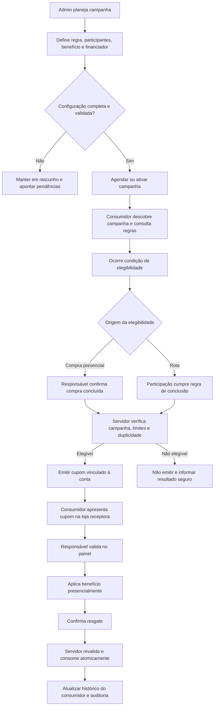

# Fluxo de campanhas e Fidelidade ao Centro

**Produto:** Vem pro Centro  
**Iniciativa:** Centro em Movimento  
**Prioridade:** P1 para campanhas e cupons simples; P2 para carteira de pontos.  
**Referências:** PRD, MVP, requisitos funcionais RF-070 a RF-084 e RF-094 a RF-099, Modelo de Domínio, Specs 005 e 007 e fluxos de compra, Rotas de Descoberta e resgate de cupom.

## Objetivo

Descrever como uma campanha é planejada, publicada, descoberta, gera um benefício elegível e termina em um resgate presencial. O fluxo conecta três momentos distintos:

1. **Origem da elegibilidade:** uma compra presencial confirmada, a conclusão de uma Rota de Descoberta ou outra condição explicitamente suportada pela campanha.
2. **Emissão:** o sistema verifica as regras e associa um cupom à conta elegível.
3. **Utilização:** o consumidor apresenta o cupom e o estabelecimento receptor valida e confirma o resgate no painel.

Campanha, concessão e resgate são operações diferentes. Criar uma campanha não concede benefício; cumprir uma condição não significa que o benefício já foi utilizado; apresentar um código não consome o cupom.

## Princípios e limites

- Toda campanha ativa possui regra, período, elegibilidade, limites, estabelecimentos envolvidos e responsável pelo custo claramente definidos.
- A campanha identifica separadamente quem origina a elegibilidade, onde o benefício pode ser utilizado e quem assume seu custo.
- Benefícios cruzados devem estimular a descoberta de outros estabelecimentos, sem transferir custos implicitamente.
- O consumidor consulta as regras antes de participar ou utilizar o benefício.
- A emissão é individual, vinculada à conta elegível e protegida contra duplicidade.
- O resgate é presencial e validado online pelo responsável autenticado da loja receptora.
- Pontos não são dinheiro. Não há conversão monetária, cashback ou carteira complexa no P1.
- Não emitir pontos ou cupons sem regra e responsável financeiro/comercial.
- Compra, reserva por WhatsApp/Instagram, check-in e conclusão de rota são eventos distintos. Uma conversa de reserva ou um QR check-in isolado não comprova compra.
- No primeiro release, campanhas são criadas e publicadas pela administração. Criação individual por proprietários fica fora do MVP.
- O fluxo não implementa checkout, pagamento, PDV, integração de estoque, equipe de loja ou carteira financeira.

## Atores e responsabilidades

| Ator | Responsabilidade |
|---|---|
| Administração da plataforma | Criar e revisar campanhas coletivas, validar participantes e regras, identificar financiador, publicar, pausar ou cancelar e acompanhar auditoria. |
| Responsável pelo custo | Assumir o benefício conforme o acordo/regra registrada. Pode ser uma loja, um conjunto de participantes ou outro patrocinador explicitamente identificado. |
| Responsável da loja de origem | Confirmar uma compra presencial concluída quando essa for a condição da campanha. |
| Consumidor | Consultar condições, cumprir a condição de elegibilidade, acompanhar cupons próprios e apresentá-los no estabelecimento receptor. |
| Responsável da loja receptora | Aplicar o benefício na venda presencial e confirmar o resgate pelo painel autenticado. |

No MVP, o responsável principal autenticado pela loja é o operador. Não existem contas de funcionários ou permissões granulares.

## Modelo de campanha

Antes da publicação, a administração precisa registrar:

- nome, descrição e objetivo da campanha;
- período de início e término;
- condição que gera elegibilidade;
- estabelecimentos participantes e seus papéis;
- benefício concedido e suas restrições;
- estabelecimento ou estabelecimentos onde o benefício pode ser utilizado;
- responsável pelo custo e, quando necessário, forma de divisão acordada;
- limite total de emissões, limite por consumidor e demais limites aplicáveis;
- validade do cupom, que pode ser diferente do período da campanha;
- regras de pausa, cancelamento, expiração e tratamento de cupons já emitidos.

### Papéis dos estabelecimentos

Uma campanha pode envolver papéis diferentes:

- **Origem:** estabelecimento cuja compra ou participação pode satisfazer a condição.
- **Receptor:** estabelecimento onde o cupom será apresentado e o benefício aplicado.
- **Financiador:** responsável pelo custo econômico do benefício.

Em uma campanha simples, os três papéis podem coincidir. Em uma campanha cruzada, podem ser diferentes. Exemplo: uma compra elegível na cafeteria pode gerar um cupom para uso na sorveteria, enquanto o custo é assumido por um patrocinador ou por uma composição acordada entre participantes. A plataforma não presume que a loja receptora, a loja de origem ou o governo pagará pelo benefício.

Uma campanha só pode ser ativada quando esses papéis e responsabilidades estiverem explícitos e aceitos.

## Visão geral

## 1. Criação e publicação da campanha

1. A administração abre a área de campanhas.
2. Cria uma campanha em estado `draft`.
3. Define a condição de elegibilidade: compra presencial confirmada, conclusão de rota ou outra condição prevista e testável.
4. Seleciona estabelecimentos e define o papel de cada um: origem, receptor ou ambos.
5. Descreve o benefício em linguagem clara, incluindo restrições.
6. Identifica o responsável pelo custo e registra o acordo aplicável.
7. Define período, validade dos cupons, limites e regras de cancelamento.
8. Revisa a apresentação pública e confirma as condições.
9. O servidor valida os campos e as relações. Se estiver completa, a campanha pode ser agendada ou ativada; caso contrário, permanece em rascunho com as pendências indicadas.

Estados conceituais: `draft → scheduled → active → ended`; campanhas ativas também podem ser pausadas ou canceladas. Alterações relevantes devem ser auditadas.

Uma campanha não pode ser ativada sem responsável pelo custo, condição de elegibilidade, período, benefício, participantes e limites. Alterações não podem invalidar retroativamente cupons já emitidos sem política explícita, comunicação e registro auditável.

### Campanhas criadas por proprietários

No primeiro release, somente a administração cria e publica campanhas. Proprietários não recebem permissão de autoria individual. Uma evolução futura exigirá revisão explícita de escopo, permissões e responsabilidade financeira.

## 2. Descoberta e consulta pelo consumidor

1. O consumidor encontra a campanha na vitrine, no detalhe de um estabelecimento, em uma Rota de Descoberta ou na área Fidelidade ao Centro.
2. Abre os detalhes sem precisar autenticar-se para consultar informações públicas.
3. Visualiza benefício, período, condição de elegibilidade, estabelecimentos de origem e receptor, validade, limites e restrições.
4. Se a condição exigir identificação individual ou emissão para a conta, autentica-se no momento necessário.
5. A interface não promete benefício antes da verificação do servidor.

A campanha deve explicar o que a pessoa precisa fazer, onde pode fazê-lo e onde poderá utilizar o benefício. Não usar textos vagos como “ganhe pontos” quando a regra real concede um cupom específico.

## 3. Origem da elegibilidade: compra presencial

A compra ocorre fora da plataforma, no estabelecimento. A conversa de WhatsApp ou Instagram não comprova venda. O mecanismo operacional completo está definido em `PURCHASE_CONFIRMATION.md` e na Spec 007.

1. O consumidor visita o estabelecimento e conclui a compra presencial.
2. O consumidor autenticado apresenta **Meu QR**, token temporário, opaco, rotativo e sem dados pessoais.
3. O responsável principal autenticado seleciona a loja, abre **Registrar compra** e escaneia o código.
4. O servidor valida token, validade, uso e associação à conta; o painel mostra apenas identificação mínima para conferência. A leitura não confirma a compra.
5. Após conferir a conta e a venda concluída, o responsável declara explicitamente a compra no painel.
6. O painel solicita somente os campos exigidos pelas campanhas aplicáveis, como valor total quando houver valor mínimo.
7. O servidor revalida autorização, estabelecimento, token, período, regras, limites e idempotência; registra a confirmação e avalia todas as campanhas de compra elegíveis para aquela loja.
8. Se elegível, emite os benefícios previstos; se não, registra o resultado sem conceder benefício indevido.
9. A operação fica auditável e idempotente: repetir a mesma requisição não gera uma segunda confirmação ou concessão.

A confirmação é uma declaração operacional do responsável, não prova de pagamento nem integração com caixa, PDV ou sistema fiscal. Registrar consumidor, operador, estabelecimento, instante, referência do token, chave de idempotência, campanhas/regras avaliadas e resultado. O valor total só é registrado quando exigido por regra. Não exigir CPF, documento, telefone, e-mail ou comprovante por padrão. O QR identifica a conta e é independente do QR de rota e do QR de cupom.

O fluxo vale tanto para compra precedida de conversa de reserva quanto para compra espontânea. A plataforma não depende de reserva prévia e não infere compra a partir de mensagem, clique, visita ou retirada isolada.

## 4. Origem da elegibilidade: conclusão de Rota de Descoberta

1. O consumidor autenticado inicia uma participação em uma rota elegível.
2. Registra os check-ins das paradas conforme o fluxo de Rotas de Descoberta.
3. O servidor verifica a regra explícita de conclusão, considerando paradas obrigatórias e opcionais.
4. Quando a participação muda para `completed`, o sistema verifica se existe campanha ativa associada à rota e se a participação atende às condições.
5. Se elegível e dentro dos limites, emite o benefício definido pela campanha para a conta participante.
6. Se não houver campanha elegível, a rota é concluída normalmente, sem recompensa.
7. A emissão é idempotente: a mesma conclusão não pode conceder o mesmo benefício novamente.

Check-in é registro de apresentação de um QR Code válido associado à parada. Isoladamente, não comprova compra nem conclusão da rota. A recompensa depende da conclusão validada e das regras da campanha. Não exigir compra em cada parada.

## 5. Emissão e consulta do benefício

No escopo P1, o benefício digital emitido é um **cupom simples de uso único**.

1. O servidor determina a elegibilidade com base no evento de origem e na versão da regra aplicável.
2. Verifica limite global, limite por consumidor, período e ausência de concessão anterior para o mesmo evento/regra.
3. Cria um cupom com identificador aleatório, opaco e não previsível, associado à conta do consumidor.
4. Define loja receptora, benefício, campanha, validade e estado `issued`.
5. O consumidor encontra o cupom em **Perfil → Fidelidade ao Centro**.
6. Consulta a descrição do benefício, estabelecimento receptor, validade, condições e estado.
7. Apresenta o QR Code ou código textual no estabelecimento.

O QR Code e o código textual são representações do mesmo identificador. O QR não contém dados pessoais. O consumidor não pode alterar localmente o estado do cupom; a situação exibida é atualizada a partir da confirmação do servidor.

Se a campanha não tiver benefício elegível para aquela participação ou compra, nenhum cupom é criado. Não transformar automaticamente uma conclusão de rota ou compra em pontos genéricos.

## 6. Benefícios cruzados

Uma campanha cruzada separa a origem da condição e o local de utilização.

Exemplo ilustrativo:

1. A cafeteria participa como estabelecimento de origem.
2. A campanha define que uma compra confirmada na cafeteria pode gerar um cupom.
3. A sorveteria participa como estabelecimento receptor.
4. O cupom informa claramente que pode ser utilizado na sorveteria, até a validade e conforme as condições publicadas.
5. O financiador do benefício é identificado antes da ativação.
6. O consumidor recebe o cupom após a compra elegível e passa a ter um motivo concreto para visitar outro estabelecimento.
7. Na sorveteria, o responsável valida e confirma o resgate pelo painel.

O exemplo não define quem paga. Essa responsabilidade precisa estar acordada e registrada na campanha. A plataforma não deve emitir um benefício cujo custo esteja indefinido nem assumir que o estabelecimento receptor aceitará qualquer desconto.

O mesmo mecanismo pode ser aplicado a recompensas por conclusão de rota: a rota gera a elegibilidade, mas o cupom pode ser resgatado em uma loja participante diferente.

## 7. Resgate presencial

O resgate segue integralmente o fluxo de `COUPON_REDEMPTION.md`:

1. Consumidor apresenta QR Code ou código textual no estabelecimento receptor.
2. Responsável autenticado seleciona a loja correta e abre **Cupons e resgates**.
3. Escaneia o QR Code ou digita o código.
4. O servidor valida existência, estado, validade, campanha, elegibilidade, limites, loja receptora e autorização do operador.
5. Se válido, o painel apresenta benefício e dados mínimos para conferência. A consulta não consome o cupom.
6. O estabelecimento aplica o benefício na venda presencial.
7. O responsável confirma o resgate.
8. O servidor revalida as condições e registra `CouponRedemption` e estado `redeemed` na mesma transação.
9. O consumidor vê o cupom como utilizado após a confirmação do servidor.

Cupom inválido, expirado, cancelado, já utilizado ou incompatível com a loja é recusado. Falha de conexão nunca pode ser apresentada como sucesso. Tentativas concorrentes não podem gerar resgates duplicados.

## 8. Histórico e continuidade da experiência

Na área **Fidelidade ao Centro**, o consumidor deve conseguir distinguir:

- cupons disponíveis;
- cupons utilizados;
- cupons expirados ou cancelados, quando for útil manter sua referência;
- campanha e condição que originaram cada benefício;
- estabelecimento receptor, validade e regras relevantes.

O histórico não é uma carteira financeira. Ele apresenta os benefícios emitidos e seus estados operacionais. Após uma compra ou resgate, a experiência pode sugerir outras campanhas, estabelecimentos, atividades e Rotas de Descoberta para incentivar a continuidade da visita ao Centro, sem exigir novas compras.

## 9. Pontos e evolução posterior

A carteira de pontos, lotes, expiração, FEFO, ledger, estornos e regras configuráveis está classificada como P2. Não faz parte do fluxo P1 de cupons simples.

Se a iniciativa evoluir para pontos, será necessário definir previamente:

- unidade e significado dos pontos, deixando explícito que não são dinheiro;
- evento que gera pontos e responsável por confirmá-lo;
- regra versionada de concessão e limites;
- origem e responsável pelo custo dos benefícios;
- validade, expiração, estorno e tratamento de compra cancelada;
- resgate, auditoria, prevenção de duplicidade e histórico;
- como pontos podem ou não ser convertidos em cupons ou outros benefícios.

Até essa decisão, não exibir saldo de pontos, conversão monetária ou promessa de acumulação genérica. Campanhas P1 concedem o benefício concreto descrito em suas regras.

## Estados alternativos e recuperação

| Situação | Resultado esperado |
|---|---|
| Campanha incompleta ou sem financiador | Não permitir ativação; apontar pendências. |
| Campanha ainda não iniciada | Exibir período futuro e não aceitar elegibilidade antecipada. |
| Campanha encerrada | Não aceitar novos eventos elegíveis fora da política publicada. |
| Campanha pausada ou cancelada | Aplicar a política divulgada para novas emissões e cupons já emitidos; preservar auditoria. |
| Consumidor não autenticado | Permitir consulta pública; solicitar login apenas quando a ação exigir associação à conta. |
| Compra não elegível | Não emitir benefício e informar resultado ao operador. |
| Compra confirmada repetidamente | Retornar o resultado da operação já processada, sem duplicar concessão. |
| Rota concluída sem campanha associada | Marcar a rota como concluída sem recompensa. |
| Limite global ou individual atingido | Não emitir novo cupom; registrar a razão operacional. |
| Cupom expirado, cancelado ou utilizado | Recusar novo resgate. |
| Loja receptora diferente da campanha | Recusar sem revelar dados desnecessários. |
| Responsável sem autorização | Bloquear a operação no servidor. |
| Falha técnica durante emissão | Não afirmar concessão; permitir consulta segura do resultado antes de repetir. |
| Falha técnica durante resgate | Não afirmar consumo; consultar estado confirmado pelo servidor. |
| Benefício aplicado, mas confirmação falha | Orientar a loja a consultar o estado antes de tentar novamente; evitar concessão duplicada ou cobrança indevida. |

## Segurança, privacidade e auditoria

- Toda autorização de criação, confirmação de compra, emissão e resgate é validada no servidor.
- A emissão e a confirmação de compra são idempotentes por evento e regra.
- O cupom possui identificador opaco, não sequencial e de uso único.
- O QR Code não contém dados pessoais.
- O painel da loja apresenta somente dados mínimos necessários para conferir o benefício.
- Não armazenar código secreto completo em logs.
- Registrar criação e alterações de campanha, responsável pelo custo, ativação, pausa, cancelamento, confirmação de compra, emissão, expiração, cancelamento e resgate.
- Correções e compensações após resgate exigem operação administrativa auditada; não reabrir cupom silenciosamente.
- A política de retenção deve ser definida antes de operar com dados reais.
- Não exigir CPF, documento, telefone ou e-mail para conferir um cupom por padrão.
- Dados de campanha não devem revelar histórico individual de consumo a outros estabelecimentos.

## Limites e decisões ainda abertas

1. **Autoria de campanhas por proprietários:** a Spec 005 mantém em aberto se essa capacidade entra no primeiro release. O fluxo assume administração centralizada no P1.
2. **Política de cancelamento:** definir tratamento detalhado de cupons emitidos quando uma campanha for pausada ou cancelada, antes da implementação.
3. **Financiamento compartilhado:** quando mais de uma parte assumir custos, definir como o acordo será representado e validado operacionalmente.
4. **Pontos:** permanecem P2 e exigem desenho próprio antes de qualquer implementação.

Essas decisões não impedem documentar a jornada P1 de campanhas com cupons simples, desde que cada campanha demonstrativa tenha regra e financiador definidos.

## Critérios de validação

- [ ] Campanha é criada em rascunho e só pode ser ativada após validação de regra, período, participantes, benefício, limites e responsável pelo custo.
- [ ] A campanha identifica estabelecimento de origem, receptor e financiador sem presumir que sejam a mesma parte.
- [ ] Consumidor consulta condições e restrições antes de participar.
- [ ] Campanha pode usar compra presencial confirmada como condição de elegibilidade.
- [ ] Responsável autorizado confirma compra concluída, inclusive quando não houve reserva prévia.
- [ ] Conversa de reserva, clique, visita ou check-in isolado não gera benefício por compra.
- [ ] Confirmação repetida da mesma compra não duplica a concessão.
- [ ] Conclusão validada de rota pode gerar cupom somente quando houver campanha elegível.
- [ ] Rota concluída sem campanha elegível não gera recompensa.
- [ ] Check-in não é tratado como compra nem como conclusão automática da rota.
- [ ] Cupom é emitido para conta elegível, com validade, loja receptora e identificador opaco.
- [ ] Consumidor consulta seus cupons e estados em Fidelidade ao Centro.
- [ ] Benefício cruzado informa origem, receptor e responsável pelo custo.
- [ ] Responsável autenticado da loja receptora valida e confirma o resgate pelo servidor.
- [ ] Validação preliminar não consome cupom.
- [ ] Confirmação após aplicação presencial consome o cupom atomicamente.
- [ ] Tentativas simultâneas e eventos repetidos não geram concessões ou resgates duplicados.
- [ ] Falhas técnicas não são apresentadas como sucesso.
- [ ] Histórico e auditoria permitem rastrear campanha, regra, origem, consumidor, receptor, operador e instante.
- [ ] O P1 não introduz carteira de pontos, conversão monetária, cashback ou FEFO.
