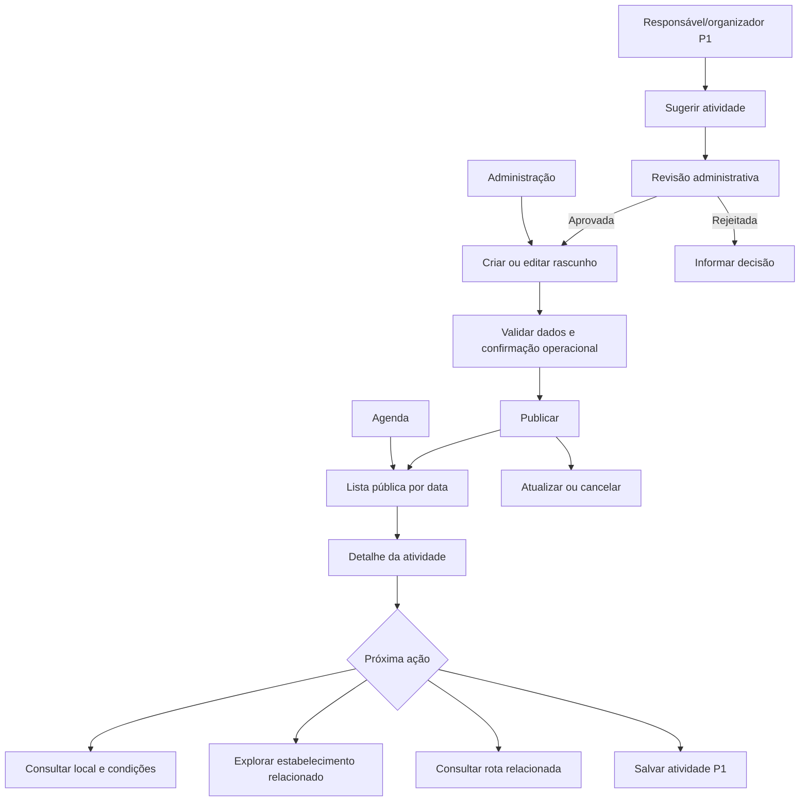

# Fluxo do Cronograma do Centro

**Produto:** Vem pro Centro  
**Prioridade:** P0 para publicação e consulta; P1 para sugestões, salvamento e associações.  
**Referências:** MVP, RF-030 a RF-041; Spec 003 | Cronograma do Centro; fluxos `CONSUMER_NAVIGATION.md`, `DISCOVERY_ROUTES.md` e `PLATFORM_ADMINISTRATION.md`.

## Objetivo

Descrever como a administração mantém a programação do Centro e como visitantes descobrem atividades, entendem suas condições e planejam uma visita.

O Cronograma deve reunir eventos culturais, feiras, oficinas, apresentações, ações comerciais e experiências comunitárias. Não é uma plataforma de venda de ingressos nem um sistema completo de inscrições.

## Visão geral

## 1. Consulta pública do cronograma

**Prioridade: P0**

1. Visitante abre **Agenda** pela navegação principal ou por um link compartilhado.
2. O sistema apresenta atividades publicadas, organizadas por data.
3. A pessoa navega entre datas e consulta os dados essenciais de cada atividade.
4. Seleciona uma atividade para abrir o detalhe.

A consulta não exige autenticação.

Cada item deve apresentar, quando disponível:

- título e resumo;
- data e horário;
- local;
- categoria;
- organizador;
- indicação gratuita ou paga;
- indicação de inscrição obrigatória ou opcional;
- estado público relevante, inclusive cancelamento.

Regras:

- Ordenar por data e horário no fuso `America/Sao_Paulo`.
- Não misturar rascunhos, atividades rejeitadas ou conteúdo não publicado na lista pública.
- Atividade cancelada deve permanecer identificável e não pode parecer confirmada.
- Não afirmar que uma atividade está ocorrendo agora sem regra de estado e horário confiáveis.
- A ausência de atividades em uma data não deve ser apresentada como falha do serviço.

## 2. Detalhe da atividade

**Prioridade: P0**

O detalhe apresenta:

- título e descrição;
- data, horário de início e término quando informado;
- local com endereço/instruções públicas;
- categoria;
- organizador e contato público opcional;
- condição gratuita ou paga, com preço quando informado;
- necessidade de inscrição;
- associações explícitas com estabelecimento ou Rota de Descoberta;
- estado atualizado da atividade.

Fluxo:

1. Visitante abre o detalhe.
2. Confere data, horário, local e condições.
3. Decide visitar, explorar conteúdo relacionado ou voltar à agenda.
4. Se a atividade estiver cancelada, recebe aviso textual destacado e não é induzido a comparecer.

Regras:

- Atividade publicada precisa ter título, descrição resumida, início e local.
- Término, quando informado, deve ser posterior ao início.
- Não publicar atividade sem confirmação operacional do organizador/local.
- Não expor telefone ou e-mail privado do organizador.
- Associação com loja ou rota só aparece quando cadastrada e válida.
- Não inventar endereço, preço, disponibilidade, acessibilidade ou informação de inscrição.

## 3. Planejamento e navegação relacionada

**Prioridade:** P0 para endereço e orientação de visita; P1 para associações explícitas com estabelecimentos e Rotas de Descoberta.

A atividade pode levar a pessoa a continuar explorando o Centro:

- abrir estabelecimento relacionado, quando houver vínculo explícito (P1);
- abrir Rota de Descoberta relacionada, quando houver vínculo explícito (P1);
- consultar outras atividades da mesma data/categoria;
- abrir serviço externo de mapas usando endereço público cadastrado, se disponível.

A interface deve deixar claro quando uma ação sai do Vem pro Centro. Não presumir integração com mapas, transporte, estacionamento ou agenda externa.

## 4. Salvar atividade

**Prioridade: P1**

1. Visitante aciona **Salvar atividade** no detalhe ou na lista.
2. Se não estiver autenticado, o sistema solicita login/cadastro e preserva o destino.
3. Após autenticação, a pessoa retorna ao detalhe e confirma a ação.
4. O sistema associa a atividade à conta.
5. A pessoa encontra atividades salvas na área pessoal definida pela navegação.

Regras:

- Salvar não é inscrição nem reserva de vaga.
- Não enviar lembrete ou notificação push no primeiro MVP.
- Se a atividade for cancelada ou alterada, a informação atualizada deve aparecer quando a pessoa consultar seus itens salvos.
- A mesma atividade não deve aparecer duplicada na lista pessoal.
- A pessoa pode remover uma atividade salva.

## 5. Sugestão de atividade por estabelecimento/organizador

**Prioridade: P1**

1. Responsável autenticado acessa a ação de sugerir atividade.
2. Informa os dados solicitados e identifica o estabelecimento/organizador responsável.
3. Envia a sugestão.
4. A atividade fica pendente de revisão administrativa e não aparece no cronograma público.
5. Administrador revisa os dados e verifica confirmação operacional do organizador/local.
6. Administrador aprova para edição/publicação, solicita correção ou rejeita.
7. O responsável recebe o resultado e, se aplicável, orientações para corrigir a proposta.
8. Somente a publicação administrativa torna a atividade visível.

Regras:

- A sugestão não é publicação automática.
- O estabelecimento não publica diretamente no cronograma no primeiro MVP.
- Não permitir que o solicitante altere uma atividade já publicada sem nova revisão.
- Não apresentar sugestão pendente como evento confirmado.
- A forma de comunicação da decisão deve ser definida sem presumir notificações push.

## 6. Administração do cronograma

**Prioridade: P0**

1. Administrador cria atividade em rascunho.
2. Preenche título, descrição, categoria, organizador, data, horário, local, gratuidade/preço e necessidade de inscrição.
3. Confirma que organizador e local estão operacionalmente alinhados.
4. Publica a atividade.
5. Pode editar informações e publicar a atualização.
6. Se a atividade não puder ocorrer, cancela explicitamente.
7. Após a data, pode marcar como concluída ou arquivar, preservando o histórico.

Regras:

- Apenas administrador publica no primeiro corte.
- Data/hora são interpretadas no fuso `America/Sao_Paulo`.
- Cancelamento não apaga registros de participação nem desaparece silenciosamente.
- Atividade passada pode ser arquivada.
- Inscrição completa, lista de presença, venda de ingresso e controle de vagas não fazem parte do primeiro corte.

## Estados alternativos e recuperação

| Situação | Comportamento |
|---|---|
| Nenhuma atividade publicada | Informar que não há atividades disponíveis para o período e permitir navegar para outras datas. |
| Atividade cancelada | Manter detalhe com estado de cancelamento explícito e atualizado. |
| Atividade alterada após ser salva | Exibir os dados atualizados na consulta da lista pessoal. |
| Data/hora inválida | Recusar gravação e indicar o campo que precisa de correção. |
| Término anterior ao início | Recusar publicação. |
| Local sem confirmação | Manter em rascunho ou pendente; não publicar. |
| Sugestão pendente | Não exibir no cronograma público. |
| Sugestão rejeitada | Informar decisão sem apresentá-la como atividade publicada. |
| Usuário sem autenticação tenta salvar | Solicitar login e retornar ao detalhe após autenticação. |
| Falha ao salvar/remover | Não apresentar sucesso; preservar estado confirmado pelo servidor. |
| Falha de carregamento | Diferenciar indisponibilidade técnica de agenda vazia. |

## Privacidade, segurança e acessibilidade

- Consulta pública não exige conta.
- Salvamento e envio de sugestão exigem autenticação.
- Apenas o autor ou administrador autorizado consulta dados privados da sugestão.
- Contatos privados não são expostos no detalhe público.
- A autorização de publicação é verificada no servidor.
- Datas e horários devem ser legíveis em telas móveis e leitores de tela.
- Cancelamento não pode ser comunicado apenas por cor.
- Controles devem funcionar por teclado e atender WCAG 2.2 AA.

## Critérios de validação

- [ ] Visitante consulta atividades sem login.
- [ ] Lista é ordenada por data/horário no fuso correto.
- [ ] Detalhe apresenta data, horário, local, organizador, preço/gratuidade e inscrição.
- [ ] Atividade cancelada permanece visível com aviso textual.
- [ ] Administrador cria, edita, publica e cancela atividade.
- [ ] Publicação exige dados obrigatórios e confirmação operacional do local/organizador.
- [ ] Término anterior ao início é recusado.
- [ ] Atividade salva exige autenticação e não equivale a inscrição.
- [ ] Usuário pode remover atividade salva sem duplicar registros.
- [ ] Sugestão P1 não aparece publicamente antes da aprovação/publicação administrativa.
- [ ] Estabelecimento/organizador não publica diretamente no primeiro MVP.
- [ ] Associações com lojas e rotas aparecem somente quando explícitas.
- [ ] Falhas técnicas são diferenciadas de agenda sem resultados.
- [ ] Navegação funciona em celular, teclado e leitor de tela.

## Limites desta definição

- Sem venda de ingressos, pagamentos ou inscrições completas.
- Sem lista de presença, capacidade ou controle de vagas no primeiro corte.
- Sem notificações push ou lembretes.
- Sem sincronização com calendários externos.
- Sem integração presumida com mapas, transporte ou estacionamento.
- Recorrência e ocorrências múltiplas dependem de decisão de modelagem registrada na Spec 003.
