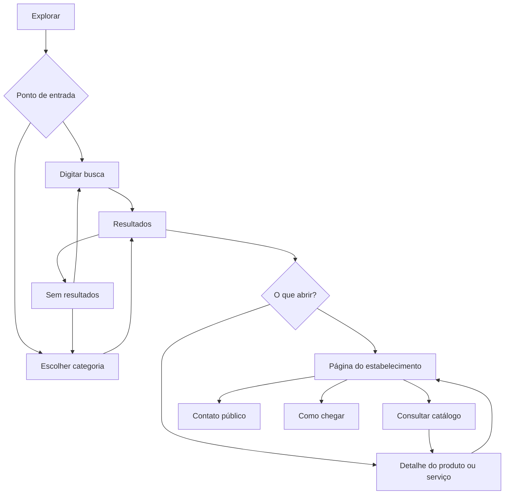

# Fluxo de descoberta comercial

**Produto:** Vem pro Centro  
**Spec de referência:** 002 | Comércio e descoberta pública  
**Status:** definição funcional da jornada pública; regras de domínio, permissões e critérios técnicos permanecem na spec.

## Objetivo

Descrever como uma pessoa encontra estabelecimentos, produtos ou serviços no Centro, entende o que cada opção oferece e escolhe um próximo passo para visitar ou entrar em contato.

A descoberta deve funcionar sem autenticação. O detalhe do produto pode preparar um pedido de reserva e abrir o canal externo de atendimento cadastrado pela loja. A plataforma não envia a mensagem nem acompanha a confirmação.

## Visão geral

## Entradas da jornada

A pessoa pode chegar à descoberta comercial por:

- seção **Explorar** na navegação principal;
- busca em destaque na tela **Início**;
- link para um estabelecimento ou produto compartilhado externamente;
- estabelecimento ou produto apresentado em uma campanha, atividade ou Rota de Descoberta.

Independentemente da origem, páginas públicas devem abrir sem exigir login. Links diretos precisam manter um caminho claro para voltar à origem ou continuar explorando.

## 1. Busca e seleção de categoria

**Objetivo:** permitir que a pessoa expresse o que procura ou comece a explorar por um segmento.

Fluxo:

1. A pessoa abre Explorar ou aciona uma busca em outra área.
2. Encontra um campo de busca e categorias disponíveis.
3. Digita um termo ou seleciona uma categoria.
4. O sistema apresenta resultados públicos compatíveis com a consulta.
5. A pessoa pode ajustar o termo, trocar ou remover a categoria e refazer a busca.

Comportamentos:

- A busca aceita nomes de estabelecimentos e produtos/serviços publicados.
- A seleção de categoria restringe a exploração às categorias ativas e aos conteúdos públicos associados.
- A interface deve deixar claro quando uma categoria está aplicada.
- Ao editar a consulta, filtros já escolhidos devem ser preservados, salvo quando se tornarem incompatíveis.
- A busca não solicita autenticação.
- Não definir neste fluxo algoritmo de relevância, ordenação patrocinada ou personalização. Esses comportamentos precisam de decisão própria e não podem ser presumidos.

## 2. Resultados

**Objetivo:** ajudar a comparar opções e escolher uma página para consultar.

Cada resultado deve identificar claramente seu tipo:

- **Estabelecimento:** nome, categoria ou segmento, resumo e imagem quando disponível.
- **Produto ou serviço:** nome, estabelecimento responsável, preço quando informado e imagem quando disponível.

Quando houver dados adequados, o resultado pode apresentar endereço resumido e disponibilidade declarada. Não transformar ausência de informação em afirmação de indisponibilidade.

Ações disponíveis:

1. Abrir a página do estabelecimento.
2. Abrir o detalhe de um produto ou serviço.
3. Ajustar a busca ou categoria.
4. Limpar filtros e iniciar outra exploração.

Regras de visibilidade:

- Exibir somente estabelecimentos aprovados e não suspensos.
- Exibir somente produtos/serviços publicados vinculados a estabelecimentos publicamente elegíveis.
- Conteúdo em rascunho, pendente, rejeitado, arquivado ou pertencente a estabelecimento suspenso não deve aparecer nos resultados públicos.
- Não revelar ao visitante o estado administrativo interno de um cadastro.
- A data de atualização do catálogo deve estar disponível na página do estabelecimento; resultados compactos não precisam repetir todos os metadados.

## 3. Página do estabelecimento

**Objetivo:** apresentar uma visão confiável do comércio e permitir que a pessoa explore o catálogo ou planeje uma visita.

Informações públicas previstas, conforme cadastro e disponibilidade:

- nome e apresentação do estabelecimento;
- categorias;
- endereço e referência de localização;
- canais de contato definidos como públicos, com WhatsApp prioritário e Instagram opcional;
- imagem de apresentação, quando disponível;
- catálogo de produtos e serviços publicados;
- preço, quando informado e aplicável;
- disponibilidade declarada;
- data da última atualização do catálogo.

Fluxo:

1. A pessoa abre o estabelecimento a partir dos resultados ou de um link direto.
2. Identifica o estabelecimento e consulta suas informações públicas.
3. Explora os produtos e serviços publicados.
4. Abre um item para consultar seus detalhes.
5. Escolhe entrar em contato, consultar outro item ou obter orientação para chegar ao local.

Regras:

- A página não deve expor telefone/e-mail privados, CNPJ ou dados internos do responsável.
- Informações não fornecidas não devem ser inventadas nem substituídas por conteúdo genérico que pareça factual.
- A data de atualização ajuda a pessoa a avaliar a atualidade do catálogo; não representa garantia de que todos os dados continuam válidos.
- A página não deve afirmar que o estabelecimento está aberto naquele momento sem uma fonte confiável e uma funcionalidade específica para isso.
- Um estabelecimento que deixe de ser elegível para exibição pública não deve continuar acessível por URL direta como se estivesse ativo.

## 4. Detalhe do produto ou serviço

**Objetivo:** permitir que a pessoa entenda a oferta antes de decidir o que fazer.

Informações previstas:

- nome e descrição;
- estabelecimento responsável;
- preço, se informado e aplicável;
- imagem, quando disponível;
- disponibilidade declarada pelo estabelecimento;
- acesso à página do estabelecimento.

Fluxo:

1. A pessoa abre um item nos resultados ou no catálogo da loja.
2. Consulta suas informações.
3. Pode abrir o estabelecimento responsável, explorar outros itens ou iniciar contato usando o canal público da loja.

Regras:

- Preço ausente não deve ser apresentado como gratuito.
- Disponibilidade é uma declaração do estabelecimento, não consulta de estoque em tempo real.
- O detalhe pode oferecer solicitação de reserva para retirada presencial, quando o produto e o estabelecimento forem elegíveis.
- O atalho de reserva abre uma conversa externa com mensagem contextualizada; não cria uma solicitação ou estado dentro do Vem pro Centro.
- No WhatsApp, a mensagem aparece preenchida e precisa ser enviada manualmente pelo consumidor.
- No Instagram, o link abre o perfil/Direct e a interface disponibiliza a mensagem para cópia, sem prometer preenchimento automático.
- A confirmação e o prazo de retirada são combinados diretamente entre consumidor e loja na conversa.
- A plataforma não sabe se a mensagem foi enviada, lida ou respondida.
- Reserva não é compra, checkout, pagamento ou entrega.
- Se o item deixar de estar publicado, a interface informa que o conteúdo não está disponível e oferece retorno ao estabelecimento ou à busca, sem expor estados administrativos internos.

## 5. Contato e orientação de visita

A descoberta deve terminar em uma ação útil, preferencialmente conectando a pessoa ao estabelecimento físico.

**Contato público e pedido de reserva**

- Apresentar somente canais que o estabelecimento marcou como públicos.
- Priorizar o WhatsApp quando houver número público cadastrado.
- O atalho de WhatsApp usa link de clique para conversa com texto contextualizado, incluindo produto, quantidade, loja e link público. O consumidor precisa revisar e enviar a mensagem.
- Quando houver Instagram público, oferecer abertura do perfil/Direct e uma mensagem sugerida para copiar. Não prometer preenchimento automático do texto.
- Identificar quando a ação abre um aplicativo ou serviço externo.
- Não afirmar que a mensagem foi enviada nem que a reserva foi confirmada.
- A confirmação e as condições de retirada são combinadas diretamente entre consumidor e estabelecimento.
- Não criar caixa de entrada, conversa interna ou sincronização de mensagens.

**Como chegar**

- Apresentar o endereço cadastrado de forma legível.
- Quando houver ação de mapa, abrir um serviço externo usando o endereço público.
- Não presumir integração com serviço de mapas, cálculo de rota próprio, transporte público ou dados de estacionamento.
- Se o endereço estiver incompleto, informar a limitação em vez de gerar uma localização precisa por inferência.

## Estados alternativos e recuperação

| Situação | Resposta da interface |
|---|---|
| Busca sem resultados | Informar que nenhum resultado publicado corresponde à consulta e permitir editar o termo ou explorar categorias. Não afirmar que o produto não existe no Centro. |
| Categoria sem conteúdo | Explicar que não há opções publicadas naquela categoria no momento e permitir escolher outra. |
| Catálogo vazio | Apresentar a página do estabelecimento sem inventar produtos; manter apenas informações públicas disponíveis. |
| Produto com disponibilidade declarada como indisponível | Manter a informação explícita e atualizada; não tratar como estoque verificado em tempo real. |
| Catálogo desatualizado | Exibir a data da última atualização e evitar garantias sobre preço ou disponibilidade. |
| Estabelecimento ou item não mais público | Exibir uma mensagem genérica de conteúdo indisponível e oferecer retorno à busca; não revelar estado administrativo. |
| Falha temporária na busca | Diferenciar erro de serviço de ausência de resultados e permitir tentar novamente. |
| Endereço ou contato ausente | Não exibir ação incompleta; permitir continuar explorando o catálogo. |
| WhatsApp ausente | Não exibir o atalho de reserva pelo WhatsApp; oferecer Instagram ou outros canais públicos cadastrados. |
| Instagram ausente | Não exibir a alternativa de Direct; manter os demais canais disponíveis. |
| Falha ao abrir canal externo | Informar a indisponibilidade do link e manter o texto sugerido disponível para cópia quando aplicável.

## Autenticação

A consulta, a busca, a abertura de estabelecimentos e a visualização de produtos/serviços são públicas.

Esta jornada não exige login para:

- pesquisar;
- filtrar por categoria;
- abrir estabelecimentos;
- consultar produtos e serviços;
- visualizar endereço e canais públicos de contato.

Ações pessoais, como salvar favoritos associados à conta, podem solicitar autenticação no momento em que forem implementadas. Após login ou cadastro, a pessoa deve retornar ao conteúdo que estava consultando.

Não criar uma conta separada para consumidor e comerciante. O acesso de proprietário ao painel é tratado no fluxo próprio.

## Limites desta definição

- Não especifica layout final, componentes visuais, tipografia ou animações.
- Não define algoritmo de busca, ranking, recomendação ou personalização.
- Não define busca por distância, geolocalização ou mapa interno.
- Não inclui checkout, pagamento, entrega ou estoque transacional. O pedido de reserva é encaminhado por link a um canal externo e está detalhado em `CUSTOMER_TO_PURCHASE.md`; não há registro ou acompanhamento da reserva na plataforma.
- Não inclui avaliações públicas ou moderação de comentários.
- Não define captura de buscas para inteligência comercial. Essa evolução exige fluxo e salvaguardas próprios, conforme a spec de inteligência comercial.
- Não define cadastro, aprovação ou edição do estabelecimento pelo proprietário; isso pertence ao fluxo do painel.

## Critérios de validação do fluxo

- [ ] A pessoa acessa Explorar sem autenticação.
- [ ] A busca aceita estabelecimentos e produtos/serviços publicados.
- [ ] A seleção de categoria leva a resultados compatíveis.
- [ ] Resultados identificam se representam estabelecimento ou produto/serviço.
- [ ] Apenas conteúdo publicamente elegível aparece em resultados e páginas diretas.
- [ ] A pessoa consegue navegar de um produto/serviço para o estabelecimento responsável.
- [ ] A página do estabelecimento apresenta catálogo e informações públicas disponíveis.
- [ ] Preço e disponibilidade são apresentados sem sugerir garantia de estoque.
- [ ] Quando houver WhatsApp público, o consumidor consegue abrir uma conversa com mensagem de reserva contextualizada.
- [ ] O consumidor precisa enviar a mensagem manualmente e a interface não presume confirmação.
- [ ] Quando houver Instagram público, o consumidor consegue abrir o perfil/Direct e copiar uma mensagem sugerida.
- [ ] Contato e orientação de visita usam somente dados públicos cadastrados.
- [ ] Busca sem resultados não é tratada como prova de ausência de oferta no Centro.
- [ ] Erros de serviço são diferenciados de resultados vazios.
- [ ] Conteúdo removido da vitrine não revela estados administrativos internos.
- [ ] Voltar preserva a consulta e o contexto de exploração sempre que possível.
