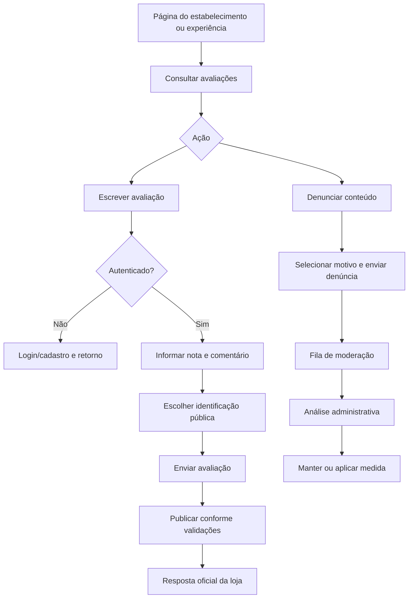

# Fluxo de comunidade e avaliações

**Produto:** Vem pro Centro  
**Prioridade:** P1 do MVP.  
**Referências:** MVP, RF-100 a RF-106, RF-105 e fluxo `PLATFORM_ADMINISTRATION.md`. Spec 008 | Comunidade e avaliações.

## Objetivo

Permitir que consumidores compartilhem avaliações sobre estabelecimentos ou experiências, que estabelecimentos respondam e que a comunidade denuncie conteúdo inadequado.

A comunidade deve oferecer informação útil sem transformar avaliações em mecanismo de punição comercial. Críticas legítimas, inclusive negativas, fazem parte do conteúdo e não devem ser removidas apenas por desagradar ao estabelecimento.

## Atores e permissões

- **Visitante:** consulta avaliações públicas.
- **Usuário autenticado:** cria avaliação e denuncia conteúdo.
- **Responsável do estabelecimento:** responde às avaliações relacionadas ao próprio estabelecimento.
- **Administrador/moderador:** analisa denúncias e aplica medidas previstas na política de comunidade.

A autoria de uma avaliação pode ser ocultada publicamente, mas permanece vinculada internamente à conta para moderação e integridade.

## Visão geral

## 1. Consultar avaliações

1. Visitante abre a página pública do estabelecimento ou experiência.
2. Consulta avaliações publicadas e respostas oficiais.
3. Visualiza nota, conteúdo, data e forma de identificação pública escolhida pelo autor.
4. Pode abrir o conteúdo relacionado ou continuar a descoberta.

Regras:

- A consulta pública não exige autenticação.
- Avaliações ocultadas/removidas por moderação não aparecem como conteúdo ativo.
- A interface deve distinguir avaliação de resposta oficial do estabelecimento.
- Não apresentar nota agregada se não houver avaliações válidas suficientes para calculá-la.
- Não permitir que avaliações sejam confundidas com certificação ou garantia da plataforma.

## 2. Criar avaliação

**Requer autenticação.**

1. Usuário aciona **Avaliar** na página do estabelecimento ou experiência.
2. Se não estiver autenticado, realiza login/cadastro e retorna ao destino.
3. Informa a nota e, quando disponível, um comentário.
4. Escolhe como deseja aparecer publicamente:
   - identificado, com a identificação pública permitida;
   - anônimo, sem exibir sua identidade na página.
5. Confere o conteúdo e envia.
6. O servidor associa a avaliação à conta autenticada e aplica validações.
7. A interface apresenta o resultado confirmado.

Regras:

- A opção anônima afeta apenas a apresentação pública, não a autoria interna.
- Não incluir automaticamente telefone, e-mail ou outros dados pessoais no conteúdo.
- Não permitir que o cliente escolha ou envie o identificador interno de autoria.
- Avaliação deve estar associada a um estabelecimento ou experiência válido.
- Não afirmar que uma compra ocorreu ou que a pessoa visitou o local se isso não foi verificado por um mecanismo próprio.
- Não criar selo de compra verificada a partir de reserva, check-in ou declaração de compra.
- Regras de quantidade, edição, exclusão e eventual vínculo com experiência real precisam ser formalizadas na spec antes da implementação.

## 3. Resposta do estabelecimento

1. Responsável autenticado acessa avaliações do estabelecimento sob sua responsabilidade.
2. Seleciona uma avaliação.
3. Escreve uma resposta pública.
4. O servidor valida a autorização e associa a resposta ao estabelecimento e ao responsável.
5. A resposta aparece identificada como manifestação oficial do estabelecimento.

Regras:

- Responsável só responde por estabelecimento sob sua responsabilidade.
- A resposta não altera a avaliação original nem sua nota.
- Não permitir resposta em nome de outro estabelecimento.
- Edição, exclusão e limite de respostas devem ser definidos na spec.
- A resposta não pode expor dados pessoais do consumidor nem incentivar assédio.

## 4. Denunciar conteúdo

1. Usuário autenticado aciona **Denunciar** em uma avaliação ou resposta.
2. Seleciona um motivo disponível e, se necessário, informa contexto objetivo.
3. Envia a denúncia.
4. O sistema registra denunciante, conteúdo, motivo e instante para análise restrita.
5. A denúncia entra na fila administrativa.
6. A pessoa recebe confirmação de que a denúncia foi registrada, sem promessa de remoção automática.

Regras:

- Denúncia não remove conteúdo automaticamente.
- Não exibir publicamente quem denunciou.
- Evitar campo livre obrigatório; se existir, orientar a não incluir dados pessoais.
- Limitar abuso de denúncias repetidas sem impedir sinalização legítima.
- A denúncia não deve ser usada para retaliar avaliação negativa.

## 5. Moderação administrativa

1. Moderador abre a fila de denúncias.
2. Consulta conteúdo, motivo e contexto mínimo necessário.
3. Avalia conforme política de comunidade.
4. Decide manter, ocultar/remover ou aplicar outra medida prevista.
5. Registra decisão, motivo, moderador e instante.
6. Comunica o resultado quando houver mecanismo de comunicação implementado.

Princípios:

- Crítica legítima não é removida apenas por ser negativa.
- Medidas devem se basear em violação objetiva da política: spam, ameaça, assédio, discriminação, exposição de dados pessoais, fraude ou conteúdo ilegal.
- A moderação deve ser proporcional e auditável.
- A autoria interna continua disponível a moderadores autorizados mesmo quando a avaliação é anônima publicamente.
- O estabelecimento não decide sozinho a remoção de avaliações.
- Não permitir que o moderador reescreva silenciosamente nota ou texto.
- Deve existir caminho de revisão/contestação, mas seu formato e prazo precisam ser definidos antes da implementação.

## Estados alternativos e recuperação

| Situação | Comportamento |
|---|---|
| Usuário não autenticado tenta avaliar | Solicitar login e retornar ao estabelecimento/experiência. |
| Conteúdo vazio ou inválido | Não enviar e indicar os campos necessários. |
| Avaliação duplicada | Aplicar política de duplicidade definida na spec; não criar múltiplos registros por reenvio técnico. |
| Avaliação anônima | Ocultar identidade pública, preservando autoria interna. |
| Denúncia enviada | Confirmar registro, sem remover conteúdo automaticamente. |
| Denúncia considerada improcedente | Manter conteúdo e registrar decisão. |
| Crítica negativa legítima | Manter conteúdo. |
| Conteúdo viola política | Aplicar medida proporcional e registrar motivo. |
| Responsável tenta responder por outra loja | Negar operação no servidor. |
| Falha ao publicar/responder/denunciar | Não apresentar sucesso; permitir consultar estado antes de repetir. |
| Conteúdo moderado | Não expor conteúdo como ativo; preservar registro e trilha conforme política de retenção. |

## Privacidade e segurança

- Autoria anônima publicamente não é anonimato perante a plataforma.
- Dados de autoria e denúncias têm acesso restrito.
- Não expor e-mail, telefone ou identificadores internos.
- Validar autorização do responsável no servidor.
- Proteger contra spam, abuso de denúncias e conteúdo malicioso.
- Definir retenção e processo de atendimento a solicitações de titulares antes de implementação.
- Registrar ações de moderação sem armazenar dados pessoais desnecessários.

## Critérios de validação

- [ ] Visitante consulta avaliações públicas sem login.
- [ ] Criar avaliação exige autenticação.
- [ ] Usuário escolhe exibição identificada ou anônima.
- [ ] Avaliação anônima não expõe identidade pública e mantém autoria interna.
- [ ] Responsável responde apenas por estabelecimento sob sua responsabilidade.
- [ ] Resposta é identificada como manifestação oficial e não altera a avaliação.
- [ ] Usuário autenticado pode denunciar avaliação ou resposta.
- [ ] Denúncia não remove conteúdo automaticamente.
- [ ] Administrador consulta denúncias e registra decisão/motivo.
- [ ] Crítica legítima não é removida apenas por ser negativa.
- [ ] Conteúdo removido/ocultado deixa de aparecer publicamente.
- [ ] Ações de moderação são auditáveis e têm acesso restrito.
- [ ] Dados pessoais e identidade de denunciantes não aparecem publicamente.

## Decisões consolidadas

- Nota inteira de 1 a 5 estrelas; comentário opcional com até 1.000 caracteres.
- Uma avaliação ativa por conta e alvo (estabelecimento ou ocorrência/experiência); edição versionada, sem duplicata.
- Autor pode editar; exclusão lógica preserva trilha mínima, sujeita à política de retenção e direitos do titular.
- Responsável pode editar/remover resposta oficial; alterações auditáveis e sem alterar a avaliação original.
- Motivos de denúncia: spam/fraude, assédio/discriminação, conteúdo ilegal, exposição de dados pessoais, conflito de interesse e outro com justificativa curta.
- Limitar denúncias repetidas e aplicar rate limit. Denúncia não oculta conteúdo automaticamente.
- Moderador decide manter, ocultar ou remover com motivo. Usuário afetado pode solicitar uma revisão uma vez pelo canal administrativo.
- Identificação pública usa nome de exibição escolhido pelo usuário; nunca nome legal, telefone, e-mail ou ID interno. Anonimato público preserva autoria interna restrita.
- Retenção, exclusão e anonimização seguem política publicada e solicitações válidas dos titulares. Prazo operacional deve ser aprovado antes da produção, sem presumir prazo legal.
