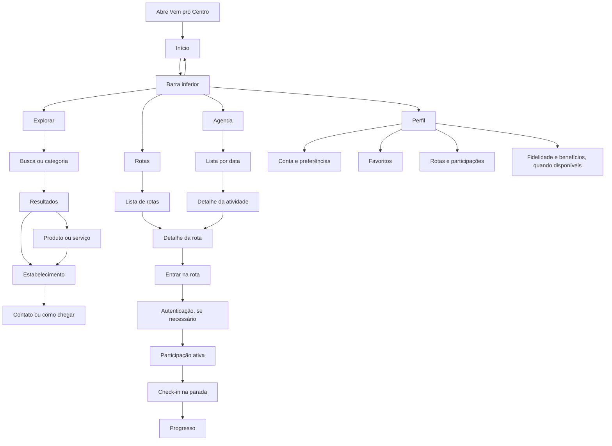

# Fluxo de navegação | Consumidor

**Produto:** Vem pro Centro  
**Status:** primeira definição de navegação; detalhes de tela e regras de negócio permanecem nas specs correspondentes.

## Objetivo

Definir como o consumidor se desloca entre as cinco áreas principais do aplicativo e como chega às jornadas de descoberta, Rotas de Descoberta e Cronograma do Centro.

A navegação deve ser familiar e previsível. A referência é o padrão de navegação inferior comum em aplicativos móveis, incluindo a familiaridade de uso do Instagram. Não reproduzir identidade visual, marca ou componentes proprietários de outro produto.

## Estrutura principal

Em dispositivos móveis, a navegação principal fica em uma barra inferior persistente, com cinco destinos e rótulo textual sempre visível:

| Ordem | Destino | Responsabilidade |
|---|---|---|
| 1 | **Início** | Ponto de entrada e descoberta editorial do Centro. |
| 2 | **Explorar** | Busca e exploração de estabelecimentos, produtos, serviços e categorias. |
| 3 | **Rotas** | Descoberta de percursos, detalhes, participação e progresso. |
| 4 | **Agenda** | Cronograma de atividades, eventos e experiências. |
| 5 | **Perfil** | Conta, favoritos, histórico e recursos pessoais disponíveis. |

A barra permanece visível nas telas principais dessas áreas. Telas de detalhe podem manter a barra quando isso não prejudicar a tarefa; fluxos imersivos, como leitura de QR Code, podem ocultá-la temporariamente e devem oferecer saída clara.

## Mapa de navegação

## Fluxos por seção

### 1. Início

**Objetivo:** apresentar caminhos úteis para descobrir o Centro sem transformar a tela em um catálogo interminável.

Entradas possíveis para outras jornadas:
- busca em destaque, direcionando para Explorar;
- estabelecimentos e produtos em evidência;
- atividades próximas ou relevantes, direcionando ao detalhe na Agenda;
- Rotas de Descoberta publicadas;
- campanhas ou benefícios ativos, quando disponíveis.

Regras:
- os blocos devem levar a destinos completos, não abrir becos sem saída;
- conteúdo indisponível ou inexistente deve ter estado vazio compreensível;
- a tela não exige autenticação;
- a composição exata, quantidade e ordem dos blocos serão decididas no fluxo de conteúdo e no protótipo, não nesta definição de navegação.

### 2. Explorar

**Objetivo:** ajudar a pessoa a encontrar uma loja, produto ou serviço.

Fluxo:
1. Consumidor abre Explorar.
2. Digita uma busca ou seleciona uma categoria.
3. Visualiza resultados publicados.
4. Aplica ou remove filtros disponíveis.
5. Abre um estabelecimento ou produto/serviço.
6. Consulta descrição, preço quando aplicável, disponibilidade declarada, endereço, contato e atualização do catálogo.
7. Escolhe um próximo passo: consultar outros produtos, abrir a página da loja, entrar em contato ou obter orientação de deslocamento.

Regras:
- busca e consulta são públicas;
- resultados não devem apresentar produtos de lojas não aprovadas ou suspensas;
- disponibilidade é declarada pelo estabelecimento e deve ser apresentada como tal;
- a ausência de resultado oferece orientação para ampliar ou alterar a busca, sem afirmar que o produto não existe no Centro;
- contato pode direcionar a canal externo informado publicamente pelo estabelecimento;
- não há checkout, pagamento ou garantia de estoque no MVP.

### 3. Rotas

**Objetivo:** transformar descoberta digital em visita e exploração presencial.

Fluxo:
1. Consumidor abre Rotas.
2. Consulta rotas publicadas e seus resumos.
3. Abre uma rota e entende tema, período, paradas, ordem sugerida e regra de conclusão.
4. Decide participar.
5. Se não estiver autenticado, entra ou cria uma conta; após autenticar, retorna à rota pretendida.
6. Inicia participação.
7. Consulta as paradas e se desloca até uma delas.
8. Registra check-in pelo mecanismo disponível no local.
9. Visualiza progresso atualizado.
10. Conclui quando a regra explícita da rota for satisfeita.

Regras:
- consultar rotas não exige login;
- iniciar participação e registrar check-in exigem autenticação;
- paradas obrigatórias e opcionais devem ser visualmente e textualmente distintas;
- paradas opcionais não bloqueiam a conclusão;
- nenhuma parada exige compra por padrão;
- QR Code é um registro de participação, não prova antifraude absoluta de presença;
- check-in inválido, duplicado ou fora do período deve receber explicação compreensível;
- se uma rota for cancelada ou expirada durante a participação, informar o estado e o efeito sobre o progresso.

### 4. Agenda

**Objetivo:** permitir que a pessoa escolha quando visitar o Centro a partir de atividades concretas.

Fluxo:
1. Consumidor abre Agenda.
2. Consulta atividades por data.
3. Seleciona uma atividade.
4. Consulta descrição, horário, local, organizador, preço/gratuidade e necessidade de inscrição.
5. A partir do detalhe, pode abrir o local, estabelecimento relacionado ou Rota de Descoberta associada, quando houver.

Regras:
- consulta pública sem login;
- atividade cancelada continua identificável como cancelada;
- data e horário seguem o fuso America/Sao_Paulo;
- inscrição não é presumida como disponível;
- não apresentar atividade passada como futura ou ativa.

### 5. Perfil

**Objetivo:** reunir dados e ações pessoais sem bloquear a descoberta pública.

Conteúdo previsto, conforme funcionalidades implementadas:
- dados básicos da conta e preferências;
- favoritos;
- participações e progresso de Rotas de Descoberta;
- benefícios e histórico de Fidelidade ao Centro;
- **Meu QR**, para identificação temporária da conta em confirmações de compra presencial;
- avaliações e contribuições;
- acesso ao painel do estabelecimento, caso a pessoa tenha responsabilidade por uma loja.

Regras:
- visitante não autenticado pode consultar as demais áreas; ao abrir Perfil, recebe opção clara de entrar ou criar conta;
- a mesma conta representa a pessoa, independentemente de atuar como consumidor ou comerciante;
- recursos ainda não implementados não devem aparecer como se estivessem disponíveis;
- Meu QR exige autenticação e apresenta token temporário, opaco e sem dados pessoais; ele identifica a conta, não comprova pagamento;
- dados pessoais e histórico de participação são privados.

## Autenticação e retorno à jornada

Autenticação deve ser solicitada no momento em que a pessoa tenta executar uma ação que exige identidade, não ao abrir o aplicativo.

Ações que podem exigir autenticação:
- iniciar uma Rota de Descoberta;
- registrar check-in;
- salvar favoritos associados à conta;
- consultar recursos privados do Perfil;
- gerar e apresentar Meu QR para associar uma compra presencial à conta;
- participar de benefícios que exijam identificação.

Quando a autenticação interromper uma jornada:
1. guardar o destino e a ação pretendida;
2. concluir login ou cadastro;
3. retornar ao destino original;
4. revalidar se a ação ainda é permitida;
5. executar a ação somente após confirmação explícita do usuário.

Não criar contas separadas de consumidor e comerciante. O acesso ao painel do estabelecimento é uma capacidade adicional da mesma conta, condicionada à autorização.

## Comportamento de navegação

- Trocar de seção não deve apagar busca, filtros ou progresso sem motivo.
- Ao abrir um detalhe a partir de uma lista, voltar deve preservar o contexto anterior sempre que possível.
- Links internos podem abrir detalhes de outra seção sem perder a origem; ao voltar, retornar à tela anterior.
- A seção ativa deve ser perceptível por ícone, rótulo e estado visual, nunca apenas por cor.
- A barra inferior não deve encobrir conteúdo, controles ou foco de teclado.
- Ações externas, como abrir mapas ou canais de contato, devem ser identificadas antes de sair do aplicativo.

## Responsividade e acessibilidade

- Mobile-first: barra inferior persistente, com alvos confortáveis e uso por uma mão.
- Telas maiores: a navegação pode mudar de apresentação, preservando os mesmos cinco destinos e sua hierarquia.
- Ícones sempre acompanhados de rótulos textuais.
- Foco visível, ordem de navegação lógica, suporte a teclado e leitor de tela.
- Respeitar contraste e critérios WCAG 2.2 AA.
- Considerar safe areas e não deixar a barra fixa cobrir conteúdo.
- Respeitar `prefers-reduced-motion`.

## Fora do escopo desta definição

- Layout visual final, cores, tipografia, dimensões e animações.
- Conteúdo editorial definitivo do Início.
- Algoritmo de recomendação ou personalização.
- Notificações push.
- Checkout, pagamento, entrega ou estoque em tempo real.
- Detalhamento do painel do proprietário.
- Regras de domínio completas de campanhas, cupons e reservas.

Esses pontos pertencem às respectivas specs e fluxos próprios.

## Critérios de validação do fluxo

- [ ] As cinco seções estão acessíveis pela navegação principal.
- [ ] A descoberta pública funciona sem login.
- [ ] Busca leva a resultados e detalhes de estabelecimento/produto.
- [ ] Agenda leva ao detalhe da atividade e a rotas relacionadas quando aplicável.
- [ ] Rotas podem ser consultadas sem login.
- [ ] A autenticação retorna a pessoa à ação que iniciou.
- [ ] Participação e check-in só são acessíveis após autenticação.
- [ ] Perfil reúne recursos pessoais e acesso autorizado ao painel da loja.
- [ ] Voltar preserva o contexto da lista ou busca de origem.
- [ ] Estados vazios, erros, cancelamentos e ações externas são comunicados claramente.
- [ ] Navegação é utilizável por teclado, leitor de tela e telas móveis.
