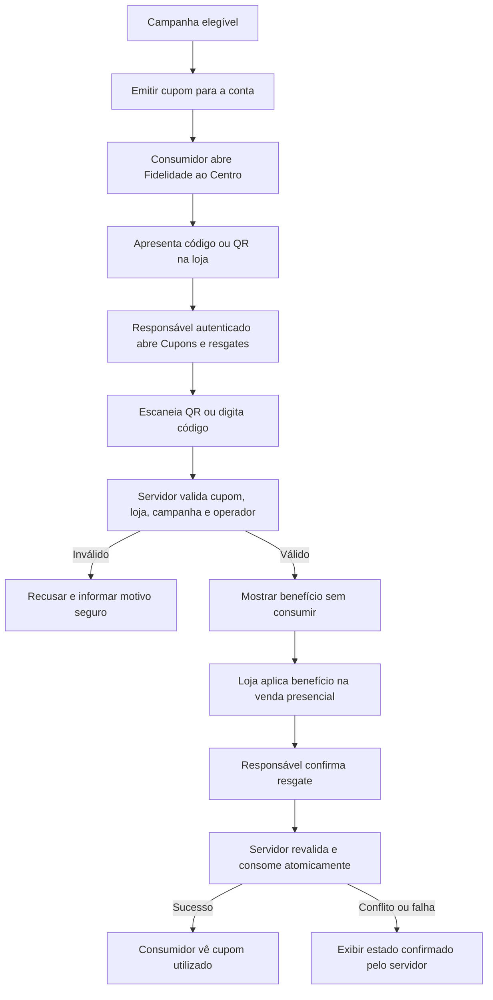

# Fluxo de resgate de cupom | Fidelidade ao Centro

**Produto:** Vem pro Centro  
**Prioridade:** P1  
**Referências:** PRD, MVP, Modelo de Domínio e Spec 005.

## Objetivo

Descrever como o consumidor apresenta um benefício e como o estabelecimento confirma que o cupom é válido, elegível e ainda não utilizado. A validação ocorre no servidor, pelo painel autenticado da loja receptora.

## Princípios

- Cupom é emitido para uma conta elegível e fica associado a ela.
- Código textual e QR Code representam o mesmo identificador opaco e não previsível.
- O consumidor apresenta o benefício no estabelecimento físico.
- O responsável autenticado da loja receptora consulta e confirma o resgate pelo painel.
- A validação preliminar não consome o cupom.
- O resgate só é concluído depois que o benefício é aplicado presencialmente e o operador confirma.
- O servidor revalida as condições e consome o cupom atomicamente.
- Capturas de tela ou mensagens não comprovam validade.
- O fluxo não exige pagamento pela plataforma nem cria carteira financeira.

## Visão geral

## Jornada do consumidor

1. Abre **Perfil → Fidelidade ao Centro**.
2. Consulta cupons disponíveis, regras, validade e estabelecimento receptor.
3. Seleciona o cupom e apresenta código textual ou QR Code no estabelecimento.
4. Aguarda validação pelo painel da loja.
5. Depois da confirmação do servidor, visualiza o estado atualizado como utilizado.

O consumidor não deve interpretar o código visual como confirmação de validade. A validade é consultada online pelo estabelecimento no momento do atendimento.

## Jornada do responsável pelo estabelecimento

1. Entra no Vem pro Centro com a conta responsável pela loja.
2. Seleciona o estabelecimento receptor.
3. Abre **Cupons e resgates**.
4. Lê o QR Code pela câmera do dispositivo ou digita o código textual.
5. O servidor verifica existência e estado do cupom, validade, campanha, elegibilidade, limites, loja receptora e autorização do responsável.
6. Se válido, o painel mostra benefício, campanha, validade, loja receptora e identificação mínima do consumidor.
7. O responsável confere a apresentação e aplica o benefício na venda presencial.
8. Seleciona **Confirmar resgate**.
9. O servidor revalida as condições e registra CouponRedemption e estado `redeemed` na mesma transação.
10. O painel confirma o sucesso somente após resposta positiva do servidor.

A validação preliminar é somente leitura. Se o consumidor desistir ou a venda não ocorrer antes da confirmação, o cupom continua `issued`, desde que permaneça válido.

## Estados e respostas

| Estado/situação | Resultado |
|---|---|
| Cupom emitido, válido e elegível | Exibir benefício e permitir confirmação após aplicação presencial. |
| Cupom já resgatado | Recusar nova utilização. |
| Cupom expirado ou cancelado | Recusar. |
| Campanha pausada/cancelada | Aplicar a política publicada; não aceitar operação proibida. |
| Loja não participante | Recusar sem revelar dados desnecessários. |
| Operador sem autorização | Bloquear consulta detalhada e resgate. |
| Código inexistente | Informar que não foi encontrado. |
| Falha de conexão | Não afirmar sucesso; consultar novamente o estado no servidor. |
| Tentativas simultâneas | Apenas uma confirmação pode concluir. |
| Consumidor desiste antes de confirmar | Não consumir o cupom. |

## Segurança, privacidade e integridade

- Código aleatório, opaco, não sequencial e de uso único.
- QR Code não contém nome, telefone, e-mail ou outros dados pessoais.
- Código textual e QR Code são duas representações do mesmo identificador.
- Painel nunca confia em estado armazenado no navegador ou em captura de tela.
- Consulta e confirmação exigem autorização server-side por estabelecimento.
- Confirmação repete validações e consome atomicamente; restrição única impede duplicidade.
- Aplicar limitação de tentativas para códigos inválidos e evitar respostas que permitam enumerar cupons.
- Logs não armazenam o código secreto completo.
- Operador visualiza apenas dados mínimos para conferir o benefício.
- O identificador pode ser compartilhado; quem o apresentar primeiro pode tentar utilizá-lo. Validação online e uso único reduzem riscos, mas não provam a identidade física do portador.
- Benefícios de alto valor podem exigir confirmação adicional definida pela campanha. Não solicitar CPF ou documento por padrão.
- Correções após resgate exigem operação administrativa auditada; não reabrir o cupom silenciosamente.

## Limites do MVP

- Sem validação por WhatsApp, Instagram ou operação offline.
- Sem checkout, pagamento ou integração com PDV.
- Sem contas de funcionários ou permissões granulares; o responsável principal opera o painel.
- Sem carteira complexa de pontos, cashback ou conversão monetária.
- Sem alegação de antifraude absoluta ou prova de identidade do consumidor.
- Sem integração de estoque em tempo real.

## Critérios de validação

- [ ] Consumidor consulta e apresenta cupom associado à sua conta.
- [ ] QR Code e código textual representam o mesmo identificador.
- [ ] Responsável autenticado abre Cupons e resgates da loja elegível.
- [ ] Painel lê QR ou recebe código digitado.
- [ ] Servidor valida campanha, validade, elegibilidade, limites, loja e operador.
- [ ] Validação preliminar não consome cupom.
- [ ] Responsável aplica o benefício presencialmente e confirma o resgate.
- [ ] Servidor revalida e registra o consumo atomicamente.
- [ ] Cupom utilizado, expirado, cancelado, inexistente ou incompatível é recusado.
- [ ] Tentativas concorrentes não geram resgates duplicados.
- [ ] Falha técnica não é apresentada como sucesso.
- [ ] Dados privados e segredo completo não aparecem em logs ou respostas indevidas.
