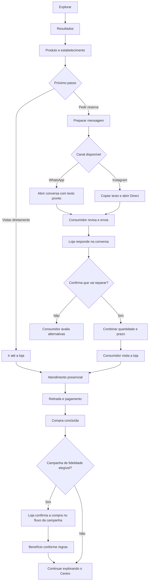

# Fluxo do consumidor: descoberta até compra

**Produto:** Vem pro Centro  
**Referências:** PRD, MVP, Spec 002 | Comércio e descoberta pública e Spec 007 | Confirmação de compra presencial.  
**Status:** definição funcional da jornada de compra presencial e pedido de reserva por canal externo.

## Objetivo

Descrever como a descoberta digital pode levar o consumidor até uma compra realizada fisicamente no estabelecimento, incluindo a possibilidade de pedir que a loja separe um produto antes da visita.

A solicitação de reserva acontece por conversa direta entre consumidor e estabelecimento. O Vem pro Centro prepara o contato, mas não mantém uma caixa de entrada, não acompanha a conversa e não registra se a reserva foi aceita.

## Princípios

- Descoberta pública não exige autenticação.
- A pessoa pode visitar a loja e comprar espontaneamente, sem reservar.
- Solicitar reserva não exige conta no Vem pro Centro: a conversa acontece no WhatsApp ou Instagram do estabelecimento.
- Abrir um aplicativo de mensagens não envia a mensagem automaticamente. O consumidor revisa e envia.
- A reserva só é considerada combinada quando o estabelecimento confirma diretamente na conversa.
- A plataforma não sabe se a mensagem foi enviada, lida ou respondida.
- O prazo e as condições de retirada são combinados entre consumidor e loja na conversa.
- Retirada e pagamento acontecem presencialmente.
- Conversar sobre reserva não confirma uma compra para fins de fidelidade.
- Benefício por compra exige confirmação explícita do responsável via Meu QR e campanha elegível; reserva, clique, visita ou check-in não substituem a confirmação.
- O consumidor deve poder continuar explorando o Centro depois da compra.

## Visão geral

## 1. Descoberta e avaliação

1. O consumidor abre Explorar, uma campanha, uma rota ou um link compartilhado.
2. Pesquisa por produto, serviço, categoria ou estabelecimento.
3. Abre o detalhe do produto e identifica a loja responsável.
4. Avalia descrição, preço informado, imagens, endereço, canais de contato e disponibilidade declarada.
5. Consulta a data de atualização do catálogo para entender a atualidade das informações.

A interface não deve tratar disponibilidade declarada como confirmação de estoque. Preço e disponibilidade podem mudar antes da visita.

## 2. Escolha do próximo passo

A partir do produto, o consumidor pode:

- **Visitar diretamente:** consultar endereço e canais públicos e ir até a loja. Não precisa criar conta nem solicitar reserva.
- **Pedir para reservar:** preparar uma mensagem para perguntar se a loja consegue separar determinada quantidade para retirada presencial.
- **Continuar explorando:** comparar outros produtos e estabelecimentos antes de decidir.

A reserva é uma conversa, não uma transação ou solicitação criada no Vem pro Centro.

## 3. Pedido pelo WhatsApp

O WhatsApp é o canal prioritário para pedir a reserva.

1. O consumidor informa a quantidade desejada no detalhe do produto, quando a interface oferecer esse campo.
2. Seleciona **Pedir reserva pelo WhatsApp**.
3. O sistema abre o WhatsApp ou WhatsApp Web usando o número público cadastrado pelo estabelecimento.
4. O campo de mensagem aparece preenchido com um texto contextualizado.
5. O consumidor revisa o conteúdo, pode editá-lo e toca em enviar.
6. A conversa continua diretamente entre consumidor e estabelecimento.

A mensagem sugerida deve conter somente nome público do estabelecimento, nome do produto, quantidade desejada, link público do produto e a pergunta sobre disponibilidade e possibilidade de separação para retirada.

Exemplo de texto preparado:

> Olá! Encontrei este produto no Vem pro Centro e gostaria de consultar a possibilidade de reservar:
>
> Produto: [nome do produto]  
> Loja: [nome do estabelecimento]  
> Quantidade: [quantidade]  
> Link: [link do produto]
>
> Vocês conseguem confirmar a disponibilidade e informar até quando poderiam deixar separado para retirada?

O texto é apenas um rascunho. O Vem pro Centro não envia a mensagem em nome do consumidor.

O link usa o formato de clique para conversa do WhatsApp, com número completo em formato internacional e texto codificado para URL. A aplicação não precisa da API do WhatsApp Business para esse comportamento.

## 4. Alternativa pelo Instagram

Quando o estabelecimento cadastrar um perfil público do Instagram:

1. O consumidor seleciona **Falar pelo Instagram** ou **Perguntar sobre reserva no Instagram**.
2. A interface disponibiliza uma mensagem contextualizada para copiar.
3. O consumidor abre o perfil/Direct pelo link cadastrado.
4. Cola, revisa e envia a mensagem.
5. A loja confirma ou recusa diretamente nessa conversa.

O Instagram é um canal alternativo. Não assumir que o Direct aceita texto pré-preenchido por link. Caso o link direto de mensagem não funcione em determinado contexto ou dispositivo, oferecer o perfil público e manter o texto disponível para cópia.

WhatsApp permanece prioritário para o pedido com texto pré-preenchido.

## 5. Confirmação e retirada

O consumidor considera a reserva combinada somente depois de receber uma confirmação explícita do estabelecimento na conversa.

Na resposta, a loja deve confirmar produto e quantidade que consegue separar, que o item ficará reservado, o prazo ou horário limite para retirada e eventuais condições necessárias.

O consumidor mantém essa confirmação na própria conversa e comparece ao estabelecimento dentro do prazo combinado.

Se a loja não responder, não confirmar a disponibilidade ou recusar o pedido, o consumidor pode conversar novamente, escolher outro produto ou visitar a loja. A plataforma não altera nenhum estado e não envia notificações sobre a conversa.

A entrega do produto e o pagamento acontecem presencialmente. Não existe confirmação de retirada dentro do Vem pro Centro nesta jornada.

## 6. Compra e Fidelidade ao Centro

A conversa de reserva e a compra são eventos distintos.

- A conversa de reserva não comprova que houve compra.
- A retirada do produto não concede benefício automaticamente.
- Se houver campanha que conceda benefício por compra, o consumidor apresenta **Meu QR** no estabelecimento após concluir a venda. O responsável seleciona a loja, escaneia o token temporário pelo painel, confere a conta e confirma explicitamente a compra.
- O servidor registra a declaração do lojista de forma auditável e idempotente e avalia as campanhas elegíveis. Uma confirmação pode avaliar várias campanhas; o valor só é solicitado quando uma regra exigir.
- O QR identifica a conta, mas não comprova pagamento. A plataforma não integra caixa/PDV e não exige CPF, documento ou comprovante por padrão.
- QR de consumidor é distinto dos QR Codes de check-in de rota e de resgate de cupom. Ver `PURCHASE_CONFIRMATION.md`.
- Benefícios cruzados podem incentivar o consumidor a visitar outro estabelecimento, conforme campanha ativa e responsável pelo custo.

Depois da compra, a experiência pode apresentar campanhas, rotas, atividades e outros estabelecimentos para incentivar a continuidade da visita. Não deve sugerir que a pessoa precisa comprar em todas as paradas.

## 7. Fluxo alternativo: compra espontânea

A reserva não pode ser uma etapa obrigatória.

1. O consumidor descobre o produto.
2. Consulta informações e endereço.
3. Vai diretamente à loja.
4. Realiza a compra no atendimento presencial.
5. Se uma campanha permitir registrar compras espontâneas, o consumidor apresenta Meu QR e o responsável confirma a compra pelo mecanismo definido em `PURCHASE_CONFIRMATION.md`. Caso contrário, a compra não gera benefício automaticamente.

A compra espontânea não depende de solicitação prévia nem de checkout na plataforma.

## Estados alternativos e recuperação

| Situação | Resposta |
|---|---|
| Estabelecimento sem WhatsApp público | Não exibir o atalho de reserva pelo WhatsApp; apresentar os demais canais públicos disponíveis. |
| Estabelecimento com Instagram, mas sem WhatsApp | Permitir abrir o perfil/Direct e copiar a mensagem sugerida. |
| Nenhum canal de contato cadastrado | Ocultar ações de contato e manter endereço e demais informações públicas disponíveis. |
| WhatsApp ou Instagram não instalado | Informar que a ação depende do aplicativo ou serviço externo e oferecer link/perfil público para abertura alternativa. |
| Consumidor abre o aplicativo e não envia a mensagem | Não apresentar pedido como enviado; o sistema não recebe confirmação de envio. |
| Loja não responde | O consumidor pode tentar o canal alternativo ou visitar a loja. A plataforma não define prazo nem expiração. |
| Loja informa indisponibilidade | O consumidor pode explorar outros produtos ou estabelecimentos. |
| Loja confirma a reserva | A confirmação e o prazo permanecem na conversa externa. |
| Loja cancela ou altera o combinado | A comunicação ocorre diretamente na conversa; a plataforma não recebe atualização. |
| Link de contato inválido | Informar que o canal não está disponível e permitir voltar à página do estabelecimento. |
| Produto deixa de ser publicado | Não gerar nova mensagem de reserva; oferecer retorno à loja ou à busca. |

## Autenticação, privacidade e integridade

- Consulta pública e abertura dos canais de contato não exigem login.
- A plataforma não precisa receber o número de telefone ou perfil social do consumidor para preparar a mensagem.
- Não incluir nome, telefone, e-mail, endereço ou identificadores pessoais do consumidor no texto gerado.
- Exibir somente canais que o estabelecimento cadastrou explicitamente como públicos.
- O número de WhatsApp público é distinto de telefone pessoal ou privado do responsável.
- A mensagem contém somente contexto do produto e link público.
- A abertura do link não comprova envio, leitura, resposta ou aceite.
- Não armazenar conteúdo de conversas externas.
- Não criar status, histórico de reservas, notificações ou trilha de auditoria de conversas que a plataforma não consegue observar.

## Limites do MVP

- Sem checkout, pagamento, sinal, reembolso ou carteira financeira.
- Sem entrega, frete ou logística.
- Sem integração com estoque ou PDV.
- Sem API do WhatsApp Business, webhook, automação de atendimento ou sincronização de mensagens.
- Sem caixa de entrada, status de reserva ou histórico de solicitações no Vem pro Centro.
- Sem confirmação ou expiração automática de reserva; consumidor e estabelecimento combinam as condições na conversa.
- Sem reserva de serviços com agenda complexa nesta primeira versão; a mensagem contextualizada cobre produtos cadastrados.
- Sem concessão automática de fidelidade por mensagem, conversa ou reserva.
- Sem chat interno.

## Critérios de validação

- [ ] Consumidor descobre e consulta produto sem autenticação.
- [ ] Consumidor consegue escolher visita espontânea sem reservar.
- [ ] Estabelecimento cadastra um número público de WhatsApp separado de contato privado.
- [ ] Produto elegível apresenta atalho para abrir o WhatsApp com mensagem contextualizada.
- [ ] A mensagem contém loja, produto, quantidade e link público.
- [ ] O consumidor precisa revisar e enviar a mensagem manualmente.
- [ ] A interface não afirma que a mensagem foi enviada ou que a reserva foi confirmada.
- [ ] Estabelecimento pode cadastrar perfil público de Instagram como canal alternativo.
- [ ] A opção Instagram disponibiliza texto para copiar e abre o perfil/Direct.
- [ ] A interface não promete preenchimento automático de mensagem no Instagram.
- [ ] Consumidor e loja combinam confirmação e prazo diretamente na conversa.
- [ ] Consumidor realiza retirada e pagamento presencialmente.
- [ ] Benefício de fidelidade depende de confirmação de compra e campanha elegível.
- [ ] Nenhum dado pessoal do consumidor é acrescentado automaticamente à mensagem.
- [ ] A plataforma não mantém status ou histórico de conversas externas.
