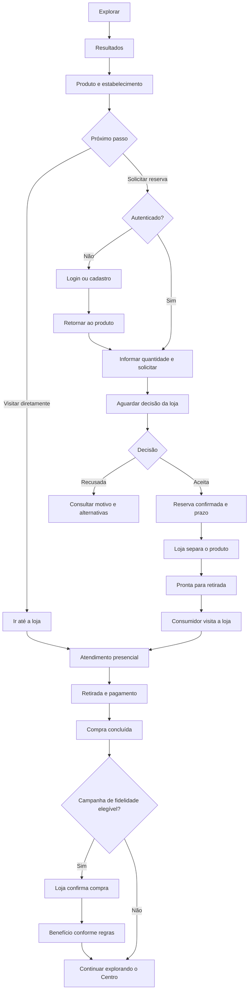

# Fluxo do consumidor: descoberta até compra

**Produto:** Vem pro Centro  
**Referências:** PRD, MVP e Spec 002 | Comércio e descoberta pública  
**Status:** definição funcional da jornada de compra presencial e reserva para retirada.

## Objetivo

Descrever como a descoberta digital pode levar o consumidor até uma compra realizada fisicamente no estabelecimento, incluindo a opção de reservar um produto para reduzir o tempo de espera e tornar a visita mais objetiva.

O Vem pro Centro facilita a descoberta e a preparação da visita. Não é marketplace transacional: não recebe pagamentos, não organiza entregas e não substitui a operação comercial da loja.

## Princípios

- Descoberta pública não exige autenticação.
- A pessoa pode visitar a loja e comprar espontaneamente, sem passar por reserva.
- Reserva é opcional e exige autenticação.
- Solicitação não equivale a reserva confirmada.
- A loja verifica a disponibilidade real e confirma explicitamente o que consegue separar.
- Retirada e pagamento acontecem presencialmente.
- Confirmar retirada não confirma automaticamente a compra para fins de fidelidade.
- O consumidor deve poder continuar explorando o Centro depois da compra.

## Visão geral

## 1. Descoberta e avaliação

1. O consumidor abre Explorar, uma campanha, uma rota ou um link compartilhado.
2. Pesquisa por produto, serviço, categoria ou estabelecimento.
3. Abre o detalhe do produto e identifica a loja responsável.
4. Avalia descrição, preço informado, imagens, endereço, contato e disponibilidade declarada.
5. Consulta a data de atualização do catálogo para entender a atualidade das informações.

A interface não deve tratar disponibilidade declarada como confirmação de estoque. Preço e disponibilidade podem mudar antes da visita.

## 2. Escolha do próximo passo

A partir do produto, o consumidor pode:

- **Visitar diretamente:** consultar endereço e canais públicos e ir até a loja. Não precisa criar conta nem solicitar reserva.
- **Solicitar reserva:** pedir que a loja separe uma quantidade para retirada presencial. Essa ação exige autenticação.
- **Continuar explorando:** comparar outros produtos e estabelecimentos antes de decidir.

Contato direto continua disponível quando o consumidor prefere confirmar algum detalhe com a loja.

## 3. Solicitação de reserva

1. O consumidor seleciona **Reservar para retirar**.
2. Se não estiver autenticado, realiza login ou cadastro e retorna ao mesmo produto.
3. Informa a quantidade desejada, limitada à quantidade permitida pela funcionalidade.
4. Confere estabelecimento, produto, quantidade e condições de retirada.
5. Envia a solicitação.
6. O sistema registra o pedido como **Solicitada** e informa que ainda depende de confirmação da loja.

A solicitação não separa o produto, não garante disponibilidade e não exige pagamento ou sinal.

## 4. Decisão da loja

A loja analisa a solicitação no Painel do Proprietário.

- **Aceita:** confirma a quantidade que será separada e informa prazo de retirada. A partir desse aceite, a reserva está confirmada.
- **Recusada:** informa um motivo curto. O consumidor pode voltar ao catálogo, escolher outra opção ou entrar em contato.
- **Sem resposta:** a solicitação permanece pendente apenas durante a janela de resposta definida pelo produto. Ao expirar, é encerrada sem reserva confirmada.

O prazo de resposta da loja e os limites máximos de retirada precisam ser parâmetros explícitos do produto, não decisões implícitas da interface.

## 5. Acompanhamento e retirada

O consumidor acompanha o estado em Perfil:

| Estado | Significado para o consumidor |
|---|---|
| Solicitada | A loja ainda não decidiu; o produto não está garantido. |
| Aceita | A loja confirmou a quantidade e o prazo de retirada. |
| Pronta para retirada | A loja informou que separou o produto. |
| Recusada | A loja não aceitou a solicitação; o motivo é apresentado. |
| Cancelada | A loja ou o consumidor cancelou antes da retirada. |
| Expirada | O prazo de resposta ou retirada terminou. |
| Retirada | A loja confirmou que o consumidor retirou o produto. |

A tela de reserva apresenta endereço, horário de atendimento cadastrado quando confiável, prazo e instruções de retirada. Não prometer que a loja está aberta em tempo real.

O consumidor se desloca até o estabelecimento, identifica a reserva e realiza o atendimento presencial. A loja entrega o produto e recebe o pagamento diretamente.

## 6. Compra e Fidelidade ao Centro

A retirada e a compra são eventos distintos.

- A loja confirma a retirada para encerrar a reserva.
- Se houver campanha que conceda benefício por compra, o responsável confirma separadamente que a compra foi concluída e informa apenas os dados mínimos necessários à regra.
- O sistema verifica elegibilidade, período, limites e idempotência antes de conceder o benefício.
- Não conceder pontos ou cupons apenas porque uma reserva foi solicitada, aceita ou retirada.
- Benefícios cruzados podem incentivar o consumidor a visitar outro estabelecimento, conforme campanha ativa e responsável pelo custo.

Depois da compra, a interface pode apresentar campanhas, rotas, atividades e estabelecimentos próximos para incentivar continuidade da visita. Não deve sugerir que a pessoa precisa comprar em todas as paradas.

## 7. Fluxo alternativo: compra espontânea

A reserva não pode ser uma etapa obrigatória.

1. O consumidor descobre o produto.
2. Consulta informações e endereço.
3. Vai diretamente à loja.
4. Realiza a compra no atendimento presencial.
5. Se uma campanha permitir registrar compras espontâneas, o responsável confirma a compra pelo mecanismo previsto na campanha. Caso contrário, a compra não gera benefício automaticamente.

A compra espontânea não depende de solicitação prévia nem de checkout na plataforma.

## Estados alternativos e recuperação

| Situação | Resposta |
|---|---|
| Consumidor não autenticado | Solicitar login apenas ao iniciar reserva e retornar ao produto após autenticação. |
| Produto deixou de ser publicado | Impedir nova solicitação e oferecer retorno à loja ou à busca. |
| Disponibilidade declarada como indisponível | Desabilitar reserva e explicar a informação publicada. |
| Solicitação pendente | Informar que ainda não existe reserva confirmada e permitir cancelar a solicitação. |
| Loja recusa | Mostrar motivo e permitir explorar alternativas. |
| Loja cancela reserva aceita | Notificar o consumidor, informar motivo e não tratar como falha do consumidor. |
| Prazo de retirada expira | Encerrar reserva, informar expiração e permitir nova consulta à loja. |
| Consumidor cancela | Registrar cancelamento e liberar a loja do compromisso de separação. |
| Produto não está disponível ao chegar | A loja deve poder registrar ocorrência/cancelamento; não afirmar que o sistema garantiu estoque. |
| Falha de conexão ao enviar | Não duplicar solicitação; informar resultado incerto e permitir consultar estado antes de reenviar. |
| Compra não elegível a campanha | Concluir retirada normalmente, sem conceder benefício. |

## Autenticação, privacidade e integridade

- Consulta pública permanece sem login.
- Solicitação, acompanhamento e cancelamento de reserva exigem autenticação.
- O consumidor vê apenas suas próprias reservas.
- O responsável vê apenas solicitações dos estabelecimentos sob sua responsabilidade.
- Alterações de estado devem registrar ator, data e estado anterior/novo para auditoria operacional.
- Reenvios não podem criar reservas duplicadas para a mesma ação.
- Exibir ao estabelecimento somente os dados necessários para processar a reserva.
- Não usar a reserva como autorização para marketing ou compartilhamento de dados.
- Aplicar limites contra abuso, spam e solicitações automatizadas.

## Limites do MVP

- Sem checkout, pagamento, sinal, reembolso ou carteira financeira.
- Sem entrega, frete ou logística.
- Sem integração com PDV ou estoque em tempo real.
- Sem baixa automática de estoque.
- Sem garantia antes do aceite explícito do responsável.
- Sem reserva de serviços com agenda complexa nesta primeira versão; o fluxo cobre produtos cadastrados.
- Sem concessão automática de fidelidade por solicitação, aceite ou retirada.
- Sem chat interno; comunicação usa estados e justificativas padronizados, além dos canais públicos da loja.

## Critérios de validação

- [ ] Consumidor descobre e consulta produto sem autenticação.
- [ ] Consumidor consegue escolher visita espontânea sem reservar.
- [ ] Solicitar reserva exige autenticação e retorna ao produto original.
- [ ] Solicitação registra produto, estabelecimento e quantidade.
- [ ] Solicitação pendente não é apresentada como reserva confirmada.
- [ ] Responsável aceita ou recusa e informa motivo quando recusa.
- [ ] Aceite confirma quantidade e prazo de retirada.
- [ ] Responsável marca produto como pronto para retirada.
- [ ] Consumidor acompanha estados e prazo no Perfil.
- [ ] Consumidor ou loja pode cancelar conforme regras.
- [ ] Reserva expira quando o prazo termina.
- [ ] Retirada é confirmada separadamente da compra.
- [ ] Benefício de fidelidade depende de confirmação de compra e campanha elegível.
- [ ] Consumidor realiza pagamento presencial diretamente à loja.
- [ ] Permissões impedem acesso a reservas de terceiros.
- [ ] Estados e transições críticas são auditáveis e idempotentes.
