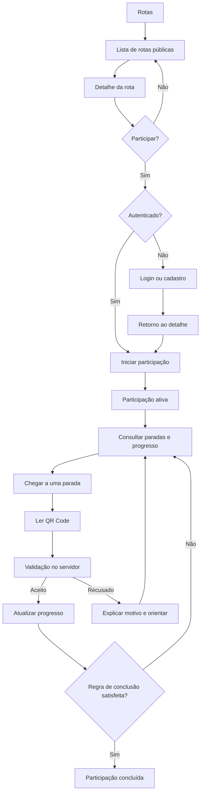

# Fluxo de Rotas de Descoberta

**Produto:** Vem pro Centro  
**Spec de referência:** 004 | Rotas de Descoberta  
**Status:** definição funcional da jornada do participante; regras de domínio, segurança e critérios técnicos permanecem na spec.

## Objetivo

Descrever como uma pessoa conhece uma Rota de Descoberta, decide participar, percorre suas paradas, registra check-ins e acompanha a conclusão.

A rota deve incentivar circulação e descoberta presencial. Não deve transformar a visita em uma sequência obrigatória de compras nem exigir GPS contínuo.

## Visão geral

## Entradas da jornada

A pessoa pode chegar a uma rota por:

- seção **Rotas** da navegação principal;
- destaque na tela **Início**;
- link compartilhado;
- atividade do Cronograma do Centro ou estabelecimento relacionado, quando houver associação explícita.

A consulta pública não exige autenticação. Links diretos devem abrir o detalhe da rota e preservar um caminho de retorno à origem.

## 1. Lista de rotas

**Objetivo:** permitir que a pessoa conheça as experiências disponíveis antes de decidir participar.

Cada item da lista deve apresentar, conforme os dados publicados:

- nome e tema da rota;
- resumo da experiência;
- período de validade, quando aplicável;
- quantidade de paradas;
- indicação de que há paradas obrigatórias e/ou opcionais;
- estado público da rota.

Fluxo:

1. A pessoa abre **Rotas**.
2. Consulta as rotas publicadas e disponíveis.
3. Seleciona uma rota para conhecer os detalhes.

Comportamentos:

- Exibir apenas rotas publicamente disponíveis para consulta.
- Rotas canceladas ou expiradas não devem parecer participáveis.
- Se não houver rotas disponíveis, explicar a ausência e oferecer retorno a Início ou Explorar.
- A listagem não exige login.

## 2. Detalhe da rota

**Objetivo:** deixar claras a proposta e as condições da experiência antes de iniciar a participação.

O detalhe apresenta:

- nome, descrição e tema;
- período de validade e situação atual;
- paradas, com nome e referência do local;
- ordem sugerida, sem sugerir obrigatoriedade quando não existir;
- distinção textual entre paradas obrigatórias e opcionais;
- instruções relevantes de cada parada;
- regra explícita de conclusão;
- indicação de que não é necessário comprar em cada parada.

Fluxo:

1. A pessoa abre uma rota.
2. Entende o percurso e consulta as paradas.
3. Verifica quais paradas são necessárias para concluir.
4. Decide iniciar a participação ou voltar à lista.

Regras de apresentação:

- Não ocultar a regra de conclusão atrás de uma ação de participação.
- Não tratar ordem sugerida como sequência obrigatória, salvo se a rota declarar isso explicitamente.
- Não prometer acessibilidade física, funcionamento do estabelecimento ou disponibilidade de atividade sem informação confirmada.
- Não apresentar QR Code ou token de check-in no detalhe público.
- Se a rota estiver indisponível, informar que não é possível iniciar uma nova participação.

## 3. Início da participação e autenticação

**Objetivo:** associar a jornada a uma conta sem exigir cadastro para a simples consulta.

Fluxo:

1. A pessoa aciona **Participar**.
2. Se não estiver autenticada, é direcionada ao login ou cadastro.
3. Após autenticar, retorna ao detalhe da rota pretendida.
4. O sistema revalida se a rota ainda aceita participação.
5. A pessoa confirma o início.
6. O sistema cria a participação e apresenta o estado ativo.

Regras:

- Iniciar participação exige autenticação.
- A mesma conta usada para consumir e para administrar uma loja representa a pessoa.
- A autenticação deve preservar a rota de origem e a intenção de participar.
- O retorno após login não deve iniciar a participação sem confirmação explícita.
- Se a rota tiver sido cancelada, expirada ou encerrada durante a autenticação, informar que não é possível iniciar.
- A política para múltiplas participações ou reentrada deve seguir a decisão registrada na spec; não presumir uma regra nova neste fluxo.

## 4. Participação ativa e percurso

**Objetivo:** orientar a pessoa durante a experiência sem transformar a interface em um rastreador de deslocamento.

A área de participação apresenta:

- identificação da rota;
- progresso atual;
- lista de paradas;
- estado de cada parada: obrigatória ou opcional, concluída ou pendente;
- ordem sugerida e instruções disponíveis;
- ação para registrar check-in na parada.

Comportamentos:

- A pessoa pode consultar o percurso sem compartilhar localização contínua.
- O progresso considera apenas check-ins aceitos pelo servidor.
- Paradas opcionais podem ser visitadas, mas não bloqueiam a conclusão.
- Nenhuma parada exige compra por padrão.
- A interface não deve sugerir que a pessoa precisa seguir uma rota geográfica rígida quando a configuração não exige sequência.
- Se uma parada estiver vinculada a estabelecimento, evento ou local, apresentar apenas informações públicas disponíveis.

## 5. Check-in por QR Code

**Objetivo:** registrar a participação da pessoa em uma parada por meio do código disponibilizado no local.

Fluxo:

1. A pessoa chega à parada.
2. Abre a ação de check-in dentro da participação ativa.
3. Lê o QR Code exibido no local.
4. A aplicação envia o token ao servidor, associado à participação autenticada.
5. O servidor valida token, rota, parada, período, estado da participação e política de repetição.
6. A aplicação apresenta o resultado.

O que a pessoa deve receber:

- **Aceito:** confirmação do registro e atualização do progresso.
- **Já registrado:** informar que a parada já consta como concluída, sem criar outro registro.
- **Token inválido, expirado ou revogado:** explicar que o código não pôde ser validado e orientar a procurar o responsável local ou retornar mais tarde.
- **Rota ou participação incompatível:** informar que o código não corresponde à participação atual.
- **Fora do período ou rota encerrada:** explicar que o check-in não pode ser registrado naquele momento.
- **Falha de conexão ou serviço:** diferenciar falha técnica de rejeição do check-in e permitir nova tentativa.

Regras:

- Check-in exige usuário autenticado e participação ativa.
- A validação acontece no servidor; a interface não decide se o token é válido.
- A gravação deve ser atômica e não pode gerar duplicidade em tentativas simultâneas.
- Token secreto não deve aparecer em logs ou mensagens de erro.
- QR Code é um registro de participação, não prova antifraude absoluta de presença.
- A interface não deve afirmar que a pessoa foi geograficamente verificada.
- A revogação imediata de token comprometido é uma capacidade administrativa mínima; rotação planejada segue prioridade posterior conforme a spec.
- Correções de check-in não devem apagar silenciosamente o histórico.

## 6. Progresso e conclusão

**Objetivo:** mostrar o que falta e explicar quando a experiência foi concluída.

Após um check-in aceito:

1. A aplicação atualiza a parada correspondente.
2. Recalcula o progresso com base nos check-ins aceitos.
3. Verifica a regra de conclusão definida para aquela rota.
4. Se a regra ainda não foi satisfeita, mantém a participação ativa.
5. Se a regra foi satisfeita, apresenta a conclusão.

A tela de conclusão deve:

- informar que a rota foi concluída;
- resumir as paradas obrigatórias registradas;
- manter visível o histórico da participação;
- oferecer retorno à lista de rotas e caminhos para continuar explorando o Centro.

Não associar automaticamente pontos, dinheiro, cupons ou benefícios à conclusão. Qualquer recompensa depende de campanha e regra próprias, fora desta jornada.

## Estados alternativos e recuperação

| Situação | Resposta da interface |
|---|---|
| Nenhuma rota disponível | Informar que não há rotas disponíveis e permitir voltar a Início ou Explorar. |
| Rota expirada ou cancelada | Exibir o estado de forma clara e bloquear novo início/check-in conforme a regra aplicável. |
| Rota indisponível após autenticação | Retornar ao detalhe com explicação; não criar participação. |
| Participação já existente | Apresentar a participação existente conforme a política definida, sem duplicar registros. |
| QR inválido, revogado ou expirado | Não atualizar progresso; explicar que o código não foi aceito. |
| Check-in duplicado | Preservar o registro existente e informar que a parada já foi contabilizada. |
| Falha de conexão | Não afirmar sucesso; permitir tentar novamente e consultar o estado confirmado pelo servidor. |
| Rota cancelada durante participação | Informar o cancelamento e o efeito sobre a participação, preservando o histórico. |
| Regra de conclusão ainda não satisfeita | Mostrar paradas obrigatórias pendentes, sem contar paradas opcionais como obrigatórias. |

## Autenticação e privacidade

- Consultar lista, detalhe e paradas é público.
- Iniciar participação e registrar check-in exige autenticação.
- A conta deve ser a mesma para as capacidades de consumidor e comerciante.
- Não solicitar GPS contínuo nem coletar localização precisa como requisito do fluxo.
- Exibir apenas os dados da participação pertencente à conta autenticada.
- Não incluir dados pessoais no QR Code ou no token.
- A interface não deve expor token secreto, detalhes internos de validação ou dados de outros participantes.

## Limites desta definição

- Não define a interface administrativa de criação e publicação de rotas; pertence ao fluxo do painel e à spec.
- Não define o formato visual do QR Code ou o mecanismo de rotação.
- Não decide a política final de repetição, reentrada ou múltiplas participações.
- Não define fallback de check-in manual pelo comerciante; a decisão permanece em aberto na spec.
- Não inclui GPS contínuo, geofencing, ranking competitivo ou gamificação complexa.
- Não concede pontos ou benefícios financeiros automaticamente.
- Não define layout final, componentes visuais, cores ou animações.

## Critérios de validação do fluxo

- [ ] Lista e detalhe de rotas podem ser consultados sem login.
- [ ] O detalhe apresenta período, paradas, obrigatoriedade e regra de conclusão.
- [ ] Paradas obrigatórias e opcionais são distinguíveis.
- [ ] A pessoa pode iniciar participação somente após autenticação.
- [ ] Após autenticar, retorna à rota pretendida e confirma o início.
- [ ] Participação ativa apresenta paradas e progresso.
- [ ] Check-in exige participação ativa e validação no servidor.
- [ ] Check-in aceito atualiza o progresso uma única vez.
- [ ] Token inválido, expirado, revogado ou incompatível não atualiza progresso.
- [ ] Falhas técnicas são diferenciadas de rejeições de check-in.
- [ ] Paradas opcionais não bloqueiam conclusão.
- [ ] A conclusão respeita a regra explícita da rota.
- [ ] A jornada não exige compra em cada parada nem GPS contínuo.
- [ ] Cancelamento e correções preservam histórico e auditoria.
