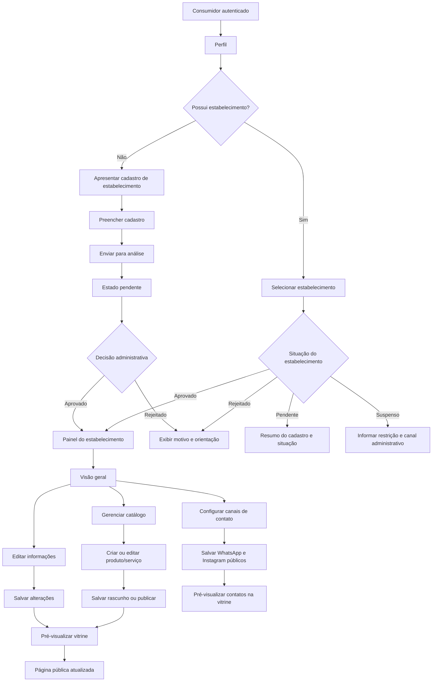

# Fluxo do Painel do Proprietário

**Produto:** Vem pro Centro  
**Spec de referência:** 002 | Comércio e descoberta pública  
**Status:** definição funcional da jornada do responsável pelo estabelecimento; permissões e regras técnicas permanecem nas specs.

## Objetivo

Descrever como uma pessoa autenticada acessa a área de gestão, seleciona um estabelecimento sob sua responsabilidade, mantém suas informações e catálogo e acompanha o que está publicado na Vitrine Digital.

O painel é uma área operacional distinta da experiência pública do consumidor, mas usa a mesma conta e autenticação. Não existe login separado de lojista.

## Princípios

- Uma conta representa uma pessoa, independentemente de atuar como consumidor ou responsável por loja.
- No MVP, cada estabelecimento possui um responsável principal.
- Uma pessoa pode administrar mais de um estabelecimento.
- O responsável só acessa e altera estabelecimentos vinculados à sua conta.
- O responsável cadastra e mantém os canais públicos de contato do estabelecimento.
- A administração aprova, rejeita ou suspende estabelecimentos.
- Dados de catálogo e disponibilidade são declarados pelo responsável, não sincronizados em tempo real.
- O fluxo deve ser simples o suficiente para manutenção recorrente por um pequeno comerciante.

## Visão geral

## 1. Entrada no painel

A entrada principal é o Perfil da navegação do consumidor. Pessoas autenticadas que possuam estabelecimento sob sua responsabilidade encontram a ação **Painel do estabelecimento**. A entrada também pode estar disponível em menu de conta, desde que não crie uma segunda identidade ou sessão.

Fluxo:
1. A pessoa abre Perfil.
2. Seleciona **Painel do estabelecimento**.
3. O servidor verifica se a conta possui pelo menos um estabelecimento associado.
4. Se possuir um único estabelecimento, abre o painel correspondente.
5. Se possuir mais de um, apresenta a seleção.
6. Se não possuir nenhum, apresenta a opção de cadastrar estabelecimento.

Regras:
- A existência de uma conta não concede automaticamente acesso a qualquer loja.
- Não confiar em identificador de loja enviado pelo navegador sem validar a relação de responsabilidade no servidor.
- Acessar o painel exige autenticação.
- A pessoa pode voltar à experiência de consumidor sem sair da conta.

## 2. Cadastro de estabelecimento

**Objetivo:** permitir que uma pessoa solicite a inclusão de um comércio na Vitrine Digital.

Campos funcionais previstos:
- nome público;
- descrição/apresentação;
- endereço e referência;
- categorias;
- número público de WhatsApp para atendimento e pedidos de reserva;
- perfil público do Instagram, opcional;
- outros canais públicos que a loja deseje exibir, quando suportados;
- dados adicionais estritamente necessários à análise administrativa, se houver finalidade definida.

Fluxo:
1. A pessoa escolhe cadastrar estabelecimento.
2. Preenche os campos obrigatórios e identifica quais contatos são públicos.
3. Revê os dados e envia.
4. O sistema valida os campos e cria o cadastro em estado pendente de análise.
5. A interface confirma o envio e explica que a publicação depende de aprovação.
6. A pessoa pode consultar a situação do cadastro.

Regras:
- Não expor telefone/e-mail privado, CNPJ ou dados internos na página pública.
- Não solicitar dados fiscais sem finalidade definida.
- Não prometer publicação imediata.
- Evitar criar múltiplos cadastros acidentais para a mesma pessoa; apresentar estabelecimentos já associados antes de iniciar outro cadastro.
- O motivo de rejeição, quando houver, deve ser apresentado de forma acionável, sem expor anotações internas.

## 3. Seleção e visão geral do estabelecimento

Se a pessoa for responsável por mais de uma loja, deve selecionar qual deseja administrar. O painel identifica claramente o estabelecimento ativo para evitar alterações na loja errada.

A visão geral apresenta:
- nome do estabelecimento e situação de aprovação/publicação;
- resumo de completude das informações essenciais;
- estado do catálogo e data da última atualização;
- atalhos para editar informações e gerenciar produtos/serviços;
- aviso de pendências que bloqueiam publicação, quando aplicável;
- link para visualizar a página pública, se publicada.

Não apresentar métricas de venda, visitas ou desempenho que não existam ou não sejam confiáveis. A visão geral é operacional no MVP, não um painel analítico.

## 4. Edição das informações do estabelecimento

A pessoa pode editar os dados sob sua responsabilidade:
- nome público;
- descrição;
- endereço;
- categorias;
- canais de contato públicos, com WhatsApp e Instagram separados de dados privados do responsável;
- imagens, quando suportadas.

Fluxo:
1. Abre **Estabelecimento** ou **Editar informações**.
2. Altera os campos necessários.
3. Visualiza quais informações serão públicas.
4. Salva.
5. O sistema valida autorização e dados.
6. A interface confirma a atualização e oferece pré-visualização pública.

Regras:
- A autorização é validada no servidor em cada operação.
- Alterações não podem atingir lojas de terceiros.
- Campos privados e públicos devem ser claramente separados.
- Se uma alteração exigir nova análise administrativa, informar isso antes do envio; não presumir que toda edição reabre aprovação.
- Erros de validação devem indicar o campo e como corrigir.

## 5. Gerenciamento do catálogo

**Objetivo:** manter produtos e serviços que aparecem na página pública do estabelecimento.

Lista de catálogo:
- nome;
- tipo (produto ou serviço);
- estado (rascunho, publicado ou arquivado);
- preço, quando aplicável;
- disponibilidade declarada;
- última atualização.

Criar ou editar item:
1. A pessoa abre **Produtos e serviços**.
2. Seleciona **Adicionar item** ou abre um item existente.
3. Informa nome, descrição, preço quando aplicável, imagem opcional e disponibilidade declarada.
4. Salva como rascunho ou publica, conforme os campos obrigatórios.
5. O sistema valida autorização, conteúdo e estado do estabelecimento.
6. A interface apresenta o resultado e permite pré-visualizar o item na vitrine.

Ações:
- **Criar:** adiciona novo item como rascunho.
- **Editar:** atualiza um item pertencente ao estabelecimento ativo.
- **Publicar:** torna o item elegível à exibição pública, se a loja estiver aprovada.
- **Arquivar:** remove o item da vitrine sem apagar o histórico operacional necessário.

Regras:
- Apenas itens publicados de estabelecimentos aprovados e ativos aparecem publicamente.
- Preço pode ser ausente quando não fizer sentido para o serviço.
- Disponibilidade é uma declaração do responsável, com data de atualização; não equivale a estoque em tempo real.
- Imagem é opcional. Falha no upload não deve apagar os demais campos já salvos.
- Não oferecer quantidade em estoque, variações complexas, importação em lote ou integração de PDV no MVP.
- Antes de arquivar, confirmar a ação e explicar que o item deixará de aparecer na vitrine.

## 6. Pré-visualização e publicação

O responsável deve conseguir entender como as informações aparecerão ao consumidor.

Fluxo:
1. Após salvar estabelecimento ou item, seleciona **Visualizar na vitrine**.
2. O sistema abre a página pública em nova tela ou modo de pré-visualização.
3. A interface distingue conteúdo publicado de rascunhos e pendências.
4. Se o conteúdo ainda não estiver elegível, explica o que falta e não simula publicação.

Regras:
- Não mostrar rascunho como conteúdo público.
- Atualizações de conteúdo publicado refletem na vitrine após validação e salvamento.
- A página pública exibe a data de atualização do catálogo.
- A pré-visualização não altera estado de publicação.

## 7. Canais públicos de contato

**Objetivo:** permitir que o responsável informe como os consumidores podem conversar diretamente com o estabelecimento.

Canais iniciais:
- **WhatsApp:** número público de atendimento. É o canal prioritário para pedidos de reserva contextualizados.
- **Instagram:** usuário/perfil público, opcional, usado para abrir o perfil/Direct e permitir que o consumidor copie uma mensagem sugerida.

Fluxo:
1. O responsável abre **Canais de contato**.
2. Informa o número de WhatsApp que a loja usa para atender consumidores.
3. Confirma que esse número pode ser exibido publicamente.
4. Opcionalmente, informa o usuário/perfil público do Instagram.
5. Salva e pré-visualiza como os canais aparecem na página pública e nos detalhes dos produtos.

Regras:
- Não presumir que o telefone pessoal do responsável é o WhatsApp comercial.
- Armazenar o número em formato internacional normalizado. Ao gerar o link do WhatsApp, usar o formato exigido pelo recurso de clique para conversa.
- O responsável é responsável por manter os dados públicos corretos e atualizados.
- O botão de pedido de reserva pelo WhatsApp só aparece quando há um número público válido.
- O Instagram é alternativo. A interface abre o perfil/Direct e oferece texto para copiar, mas não promete mensagem pré-preenchida.
- A plataforma apenas abre links externos. Não envia mensagens, não recebe respostas e não mantém status de reserva.
- A ausência de canal de contato não impede a consulta pública ao catálogo; apenas oculta as ações que dependem daquele canal.

## 8. Cupons e resgates

**Objetivo:** permitir que o responsável da loja confirme presencialmente a utilização de cupons emitidos pelo Vem pro Centro, sem depender de mensagens, capturas de tela ou conferência informal.

No MVP, o responsável principal autenticado é o operador do resgate. A área aparece para estabelecimento aprovado e participante da campanha.

Fluxo:
1. O responsável abre **Cupons e resgates** no painel.
2. Lê o QR Code pela câmera do dispositivo ou informa o código textual.
3. O painel envia o identificador ao servidor; a interface não decide validade localmente.
4. Se válido, o painel apresenta benefício, campanha, validade, loja receptora e identificação mínima do consumidor.
5. O responsável confere a apresentação e aplica o benefício na venda presencial.
6. Depois de aplicar o benefício, seleciona **Confirmar resgate**.
7. O servidor revalida cupom, campanha, loja, operador, validade e limites; registra o resgate e altera o cupom para utilizado na mesma transação.
8. O painel informa sucesso somente após confirmação do servidor.

Regras:
- QR Code e código textual representam o mesmo identificador único.
- A consulta inicial não consome o cupom. Se a venda não acontecer, o cupom continua disponível enquanto válido.
- Somente o responsável autenticado pela loja receptora ou admin autorizado pode confirmar o resgate.
- Captura de tela ou texto encaminhado não comprova validade; o painel consulta o servidor.
- A área não exibe dados privados do consumidor.
- Falha de conexão não pode ser apresentada como sucesso.
- Correções e compensações exigem operação administrativa auditada.
- Não criar usuários de equipe ou permissões granulares no MVP.

## Estados alternativos e recuperação

| Situação | Resposta da interface |
|---|---|
| Pessoa não autenticada | Direcionar ao login e retornar ao destino do painel após autenticação. |
| Conta sem estabelecimento | Apresentar cadastro e explicar que a publicação depende de aprovação. |
| Vários estabelecimentos | Exigir seleção explícita e manter o contexto da loja escolhida. |
| Cadastro pendente | Mostrar situação, data do envio e que aguarda análise; permitir editar dados se a política permitir. |
| Cadastro rejeitado | Mostrar motivo acionável e opção de corrigir/reapresentar quando permitido. |
| Estabelecimento suspenso | Bloquear alterações/publicação conforme decisão administrativa e informar canal de contato. |
| Acesso a loja de terceiro | Negar a operação no servidor sem revelar dados privados da loja. |
| Formulário inválido | Preservar dados preenchidos e apontar erros por campo. |
| Falha ao salvar | Não afirmar sucesso; manter os dados preenchidos e permitir nova tentativa. |
| Upload de imagem falha | Informar falha isoladamente e preservar os demais campos. |
| Produto arquivado | Remover da vitrine e manter opção de consultar estado no painel. |
| Sessão expirada | Solicitar autenticação novamente e retornar ao contexto anterior quando seguro. |
| Sem produtos cadastrados | Exibir estado vazio com ação para adicionar o primeiro item. |

## Autenticação, autorização e privacidade

- Painel e mutações exigem autenticação.
- A conta é a mesma utilizada na experiência de consumidor.
- Toda operação verifica no servidor a relação entre usuário e estabelecimento.
- Não há gestão de equipe, convite ou permissões granulares no MVP.
- Dados privados do responsável nunca são serializados na vitrine pública.
- Uploads devem validar tipo, conteúdo e tamanho.
- Operações administrativas de aprovação/suspensão não pertencem ao painel do proprietário.
- Ações sensíveis devem preservar histórico/auditoria conforme a spec.

## Limites desta definição

- Não define layout final, componentes, cores ou breakpoints.
- Não inclui gestão de equipe ou múltiplos usuários por estabelecimento.
- Não inclui estoque transacional, PDV, importação em lote ou integração fiscal.
- Não inclui checkout, pagamento, entrega ou estoque transacional. O painel não gerencia reservas nem conversas externas; limita-se a manter os canais públicos de contato.
- Não inclui métricas de vendas ou analytics avançado.
- Não permite ao proprietário criar/publicar rotas ou campanhas sem regras e permissões próprias.
- Não define o painel administrativo da iniciativa; aprovação é operação interna.
- Não define recuperação de senha, cadastro detalhado de conta ou autenticação social.

## Critérios de validação do fluxo

- [ ] Pessoa autenticada acessa o painel pela própria conta.
- [ ] Conta sem estabelecimento recebe caminho para cadastro.
- [ ] Cadastro de estabelecimento entra em estado pendente e não aparece publicamente antes da aprovação.
- [ ] Responsável com múltiplas lojas escolhe explicitamente o estabelecimento ativo.
- [ ] Responsável visualiza e edita somente estabelecimento associado à sua conta.
- [ ] A autorização é verificada no servidor em todas as operações.
- [ ] Responsável cria, edita, publica e arquiva produtos/serviços.
- [ ] Responsável cadastra e atualiza o número público de WhatsApp do estabelecimento.
- [ ] Responsável pode cadastrar um perfil público de Instagram como alternativa.
- [ ] Canais públicos aparecem na vitrine sem expor contato pessoal privado.
- [ ] A ausência de WhatsApp oculta o atalho de reserva, sem bloquear a vitrine.
- [ ] Produtos publicados aparecem na vitrine apenas quando a loja está aprovada e ativa.
- [ ] Rascunhos e itens arquivados não aparecem publicamente.
- [ ] Preço e disponibilidade são apresentados conforme declaração do responsável.
- [ ] Pré-visualização não publica conteúdo nem altera estados.
- [ ] Dados privados não aparecem em respostas públicas.
- [ ] Erros e falhas preservam dados preenchidos e não afirmam sucesso indevido.
- [ ] O fluxo funciona em celular, teclado e leitor de tela.
