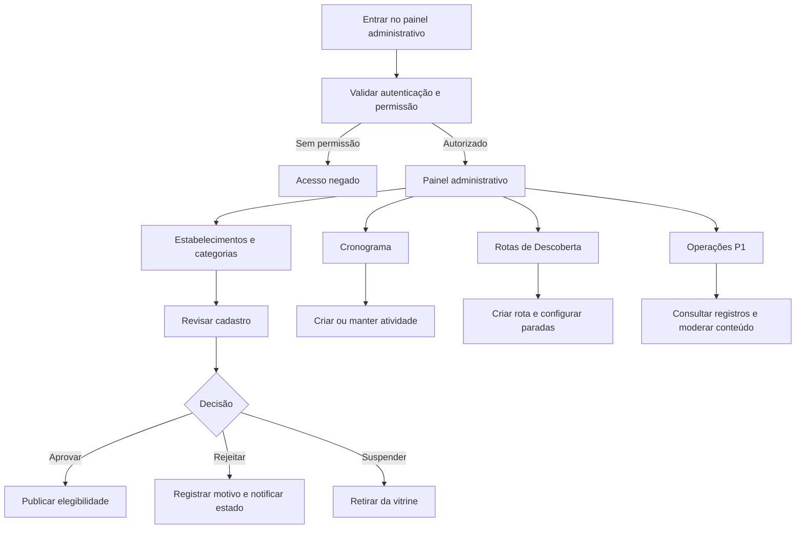

# Fluxo de administração da plataforma

**Produto:** Vem pro Centro  
**Prioridade:** P0 para operação do núcleo; P1 para auditoria operacional e moderação.  
**Referências:** MVP, RF-005, RF-015, RF-030, RF-050, RF-064, RF-105, RF-110 a RF-114; Specs 002, 003, 004, 005 e 007.  
**Escopo:** operação administrativa do produto. Inteligência institucional e pesquisas permanecem P2.

## Objetivo

Definir como a administração mantém a plataforma operável e confiável: aprova estabelecimentos, organiza categorias, publica atividades, cria Rotas de Descoberta e, nas etapas P1, acompanha operações e modera conteúdo.

A administração não substitui o responsável pelo estabelecimento na declaração de compra, não confirma reservas externas e não altera dados privados sem finalidade operacional.

## Atores e limites

- **Administrador:** usuário autorizado a operar recursos globais da plataforma.
- **Responsável de estabelecimento:** administra somente estabelecimentos sob sua responsabilidade, conforme o fluxo `OWNER_PANEL.md`.
- **Consumidor/visitante:** consulta conteúdo público e executa ações permitidas à sua conta.

Regras de acesso:

- Toda ação administrativa exige autenticação e autorização no servidor.
- A existência de uma conta comum não concede privilégios administrativos.
- A forma de provisionar e revogar contas administrativas deve ser definida na configuração operacional, sem cadastro público de administradores.
- Não criar impersonação de usuários como atalho operacional.
- Ações administrativas relevantes registram autor, instante, recurso, ação e motivo quando aplicável.

## Visão geral

## 1. Entrada e visão administrativa

1. Administrador acessa a área administrativa por rota protegida.
2. O servidor valida a sessão e a permissão administrativa.
3. O painel apresenta somente áreas e ações autorizadas.
4. A navegação permite acessar estabelecimentos, categorias, Cronograma do Centro, Rotas de Descoberta e, quando habilitados, recursos operacionais P1.

Estados alternativos:

- Sessão expirada: solicitar autenticação novamente e retornar ao destino quando seguro.
- Usuário sem permissão: negar acesso sem revelar dados internos.
- Falha de serviço: informar que a operação não foi concluída e permitir nova tentativa sem duplicar alterações.

## 2. Categorias

**Prioridade: P0**

1. Administrador consulta categorias disponíveis.
2. Cria uma categoria com nome e informações necessárias à classificação.
3. Edita dados permitidos ou ativa/inativa a categoria.
4. O sistema valida duplicidade e referências existentes.
5. Categorias ativas ficam disponíveis nos cadastros e filtros públicos.
6. Categorias inativas deixam de ser oferecidas para novos vínculos, sem apagar referências históricas.

Regras:

- Não excluir em cascata estabelecimentos ou produtos associados.
- Mudanças de categoria não devem publicar conteúdo que esteja pendente ou suspenso.
- O filtro público considera somente categorias ativas e conteúdo elegível.

## 3. Revisão de estabelecimentos

**Prioridade: P0**

1. Responsável envia cadastro pelo fluxo do painel do proprietário.
2. O estabelecimento entra em estado pendente de revisão.
3. Administrador consulta os dados necessários para avaliar o cadastro.
4. Confere informações obrigatórias, categorias, endereço e canais públicos.
5. Decide entre aprovar, rejeitar ou, quando necessário, suspender.
6. Registra a decisão e o motivo operacional.
7. A visibilidade pública acompanha o estado atualizado.

Regras:

- **Aprovado:** pode aparecer na vitrine se também estiver ativo e possuir conteúdo publicado.
- **Rejeitado:** não aparece publicamente; o motivo deve ser comunicado ao responsável de forma adequada.
- **Suspenso:** deixa de aparecer como participante oficial e não pode continuar acessível por link direto como se estivesse ativo.
- A suspensão não apaga cadastro, catálogo ou histórico.
- Administrador não deve alterar informações comerciais em nome do proprietário sem processo explícito e auditável.
- Um responsável pode possuir mais de um estabelecimento; cada recurso é avaliado individualmente.

## 4. Cronograma do Centro

**Prioridade: P0**

A administração cria, edita, publica e cancela atividades. O fluxo detalhado está em `CENTER_CALENDAR.md`.

1. Administrador cria atividade em rascunho.
2. Preenche título, descrição, categoria, organizador, data, início, local, condição gratuita/paga e necessidade de inscrição.
3. Confere se há confirmação operacional do organizador e do local.
4. Publica a atividade.
5. Atualiza informações quando necessário.
6. Se a atividade não puder ocorrer, cancela explicitamente, preservando a página e comunicando o estado.
7. Após a data, pode marcar como concluída/arquivada, preservando histórico.

Não publicar atividade sem confirmação operacional do organizador/local. Não criar inscrição, venda de ingresso ou controle de capacidade no primeiro corte.

## 5. Rotas de Descoberta

**Prioridade: P0**

1. Administrador cria rota em rascunho.
2. Define nome, tema, descrição, período quando aplicável e regra de conclusão.
3. Adiciona paradas vinculadas a estabelecimento, atividade ou local.
4. Define ordem sugerida, obrigatoriedade/opcionalidade e instruções.
5. Confere se a rota possui ao menos uma parada e regra de conclusão inequívoca.
6. Publica/ativa a rota.
7. Disponibiliza QR de check-in para cada parada configurada.
8. Acompanha incidentes e pode revogar imediatamente token comprometido ou inválido.
9. Cancela ou arquiva a rota quando necessário, preservando participações e check-ins existentes.

Regras:

- Paradas opcionais não bloqueiam conclusão.
- Nenhuma parada exige compra por padrão.
- QR registra check-in aceito, não prova antifraude absoluta de presença.
- Revogar token comprometido é P0. Rotação planejada de tokens é P1.
- Alterações que afetem participação em andamento devem informar o impacto e preservar histórico.
- Proprietários não editam rotas globais no primeiro MVP.

## 6. Moderação da comunidade

**Prioridade: P1**

1. Administrador abre a fila de denúncias.
2. Consulta conteúdo denunciado, contexto mínimo, denúncia e autoria interna necessária à moderação.
3. Avalia a denúncia conforme regras publicadas.
4. Decide manter, ocultar/remover ou encaminhar para revisão adicional.
5. Registra motivo, responsável e instante.
6. Quando aplicável, comunica a decisão às partes sem revelar dados privados de terceiros.

Princípios:

- Avaliações críticas não são removidas apenas por serem negativas.
- A moderação considera abuso, conteúdo impróprio, exposição de dados pessoais, assédio, spam ou violação objetiva das regras.
- A opção de anonimato público não elimina a autoria interna necessária à moderação.
- A administração não altera a nota ou o texto de uma avaliação para favorecer estabelecimento.
- A resposta do estabelecimento permanece identificada como resposta oficial da loja.
- Detalhamento de denúncia, estados e comunicação está em `COMMUNITY_AND_REVIEWS.md`.

## 7. Operações e auditoria

**Prioridade: P1**

Quando os recursos correspondentes estiverem implementados, o painel pode oferecer:

- consulta operacional de participações/check-ins;
- consulta de campanhas e resgates;
- indicadores agregados de operação;
- trilha de auditoria de ações críticas;
- identificação e separação de registros demonstrativos e reais.

Limites:

- Consulta operacional não autoriza editar ou apagar registros transacionais sem fluxo específico de correção.
- Registros de compra são declarações do responsável da loja, não faturamento auditado.
- Dados demonstrativos devem ser identificados e nunca misturados silenciosamente aos indicadores reais.
- Indicadores institucionais de demanda, pesquisas e inteligência comercial são P2 e não fazem parte deste fluxo administrativo do MVP.

## 8. Estados alternativos e recuperação

| Situação | Comportamento |
|---|---|
| Cadastro incompleto | Manter pendente ou devolver para correção, sem publicar parcialmente. |
| Estabelecimento rejeitado | Registrar motivo e manter fora da vitrine. |
| Estabelecimento suspenso | Remover da descoberta pública sem apagar histórico. |
| Atividade cancelada | Preservar detalhe com indicação textual clara de cancelamento. |
| Rota com parada inválida | Impedir publicação e apontar o vínculo que precisa ser corrigido. |
| QR de parada comprometido | Revogar imediatamente e registrar a ação. |
| Denúncia sem violação | Manter conteúdo e registrar decisão fundamentada. |
| Ação administrativa duplicada | Evitar duplicação por validação de estado/idempotência quando aplicável. |
| Falha durante gravação | Não apresentar sucesso; permitir consultar o estado persistido antes de repetir. |

## Privacidade e segurança

- Aplicar menor privilégio e autorização no servidor para cada recurso.
- Exibir ao administrador somente dados necessários à tarefa.
- Não expor contatos privados do responsável nas páginas públicas.
- Não armazenar tokens QR em logs.
- Registrar auditoria sem copiar desnecessariamente conteúdo pessoal.
- Restringir acesso a denúncias e autoria interna.
- Proteger uploads e formulários contra conteúdo malicioso e abuso.
- Não permitir que parâmetros enviados pelo cliente definam o papel administrativo.

## Critérios de validação

- [ ] Usuário sem permissão administrativa não acessa o painel nem executa ações por endpoint.
- [ ] Administrador gerencia categorias sem apagar referências existentes.
- [ ] Administrador aprova, rejeita e suspende estabelecimentos.
- [ ] A vitrine reflete imediatamente a elegibilidade pública do estabelecimento.
- [ ] Administrador cria, publica, edita e cancela atividades.
- [ ] Administrador cria rota com paradas Store, Event e Place, define regra e publica.
- [ ] Administrador revoga token de parada comprometido.
- [ ] Ações administrativas críticas deixam registro auditável.
- [ ] Moderação P1 preserva avaliações negativas legítimas.
- [ ] Dados demonstrativos são identificáveis e separados de dados reais.
- [ ] Falhas não são apresentadas como operações concluídas.
- [ ] Inteligência institucional P2 não aparece como funcionalidade entregue no MVP.

## Decisões operacionais pendentes

- Processo seguro de provisionamento, recuperação e revogação de administradores.
- Critérios objetivos e comunicação de rejeição/suspensão de estabelecimentos.
- Política de retenção e acesso aos registros administrativos.
- Política pública de comunidade que sustente decisões de moderação.
- Quais indicadores operacionais P1 estarão disponíveis no primeiro release.
