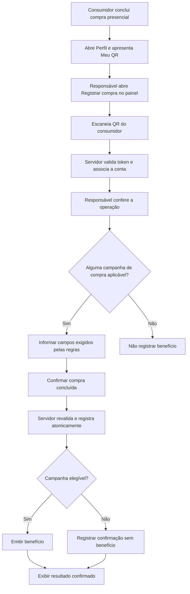

# Fluxo de confirmação de compra presencial

**Produto:** Vem pro Centro  
**Prioridade:** P1 do MVP, junto ao fluxo de campanhas e cupons simples.  
**Referências:** PRD, MVP, requisitos funcionais RF-094 e RF-095, Modelo de Domínio, Spec 005, `CUSTOMER_TO_PURCHASE.md` e `CAMPAIGNS_AND_LOYALTY.md`.

## Objetivo

Permitir que um estabelecimento associe uma compra presencial concluída à conta do consumidor e, quando houver campanha elegível, conceda o benefício previsto. O fluxo deve funcionar tanto para compras precedidas de conversa de reserva quanto para compras espontâneas.

A plataforma não processa o pagamento nem recebe confirmação de caixa. O responsável autenticado declara que a compra foi concluída. O QR Code identifica a conta do consumidor; não comprova pagamento, retirada ou entrega.

## Decisões consolidadas

- O consumidor apresenta um QR Code individual de identificação, disponível na própria conta.
- O QR Code é temporário, opaco, rotativo e não contém dados pessoais.
- O responsável principal autenticado pelo estabelecimento escaneia o código pelo painel.
- O sistema associa a conta identificada à operação e permite ao responsável confirmar a compra concluída.
- A confirmação pode avaliar todas as campanhas de compra ativas e elegíveis para aquele estabelecimento.
- O valor da compra só é solicitado quando uma regra ativa exigir, como um valor mínimo.
- Benefícios são emitidos somente depois da confirmação e da validação das regras no servidor.
- Compras espontâneas não dependem de reserva prévia.
- Uma única confirmação pode avaliar mais de uma campanha elegível, sem exigir que o consumidor apresente o QR novamente para cada campanha.
- O QR de identificação do consumidor é independente do QR das Rotas de Descoberta e do QR dos cupons.
- Não exigir CPF, documento, telefone, e-mail, comprovante de pagamento ou dados de cartão para o fluxo padrão.
- Não criar checkout, PDV, integração fiscal, integração de estoque ou carteira financeira.

## Atores e responsabilidades

| Ator | Responsabilidade |
|---|---|
| Consumidor autenticado | Abre e apresenta seu QR Code temporário para associar a compra à própria conta. |
| Responsável da loja | Confirma que a venda presencial foi concluída e informa somente os dados exigidos pelas campanhas aplicáveis. |
| Servidor | Valida token, autorização, estabelecimento, campanhas, limites, duplicidade e registra a operação. |
| Administração | Configura campanhas, consulta auditoria e corrige inconsistências por operação administrativa rastreável. |

No MVP, o responsável principal autenticado é o operador. Não há contas de funcionários, convites ou permissões granulares.

## Visão geral

## 1. Apresentação do QR pelo consumidor

1. O consumidor entra na própria conta do Vem pro Centro.
2. Abre **Perfil → Meu QR** ou o atalho equivalente.
3. A aplicação solicita ao servidor um token temporário de identificação.
4. A interface apresenta o QR Code e uma indicação visual de validade/renovação.
5. O consumidor mostra o código ao responsável da loja após concluir a compra.

O QR deve conter somente um token aleatório e opaco, sem nome, e-mail, telefone, ID sequencial ou qualquer outro dado pessoal. O token é validado exclusivamente pelo servidor.

### Validade e renovação

- O token tem validade curta, com duração inicial de referência de até 60 segundos.
- A interface solicita um novo token quando o atual expira ou é consumido.
- O servidor armazena apenas material seguro para validação, como hash do token, e controla expiração e uso.
- O token só pode ser consumido por uma confirmação de compra concluída.
- Ler o QR para iniciar a conferência não deve, por si só, registrar uma compra.
- Reutilização, expiração ou tentativa de replay são recusadas.
- A implementação deve aplicar limitação de tentativas e não revelar se um token específico pertence a determinada pessoa.

O tempo exato de validade poderá ser ajustado após teste de usabilidade e segurança, sem transformar o QR em identificador permanente.

## 2. Leitura pelo estabelecimento

1. O responsável autentica-se e seleciona o estabelecimento que está administrando.
2. Abre **Registrar compra** no painel.
3. Escaneia o QR Code apresentado pelo consumidor.
4. O painel envia o token ao servidor.
5. O servidor valida existência, validade, uso anterior e vínculo com uma conta ativa.
6. Se válido, associa a conta à operação e apresenta apenas a identificação mínima necessária para o responsável conferir que está registrando a compra para a pessoa correta.
7. O painel mantém a operação em estado de conferência até a confirmação explícita do responsável.

A identificação exibida não deve incluir telefone, e-mail, CPF ou outros dados privados. Usar apenas o nome de exibição ou identificador público configurado na conta, se necessário.

## 3. Confirmação da compra

Após a venda presencial estar concluída:

1. O responsável confere o estabelecimento e a conta identificada.
2. O servidor lista ou avalia as campanhas ativas que aceitam compra confirmada naquele estabelecimento.
3. Quando a regra exigir informação adicional, o painel solicita somente o campo correspondente. No MVP, o exemplo previsto é o valor total da compra para campanhas com valor mínimo.
4. O responsável declara explicitamente **Confirmar compra concluída**.
5. O servidor revalida autorização do operador, token, estabelecimento, período, regras, limites e duplicidade.
6. O servidor registra a confirmação e avalia a elegibilidade de cada campanha aplicável.
7. Para cada campanha elegível, emite o benefício correspondente, respeitando limites e idempotência.
8. O painel apresenta o resultado somente após a transação ser confirmada pelo servidor.

Se nenhuma campanha for elegível, a compra pode ficar registrada como confirmação sem benefício, com motivo operacional apropriado. Não conceder pontos ou cupons por padrão.

### Dados mínimos da operação

A confirmação deve registrar, no mínimo:

- conta do consumidor;
- estabelecimento;
- responsável autenticado que confirmou;
- instante da confirmação;
- referência do token temporário utilizado, sem armazenar o segredo em texto puro;
- campanhas e versões de regras avaliadas;
- resultado de elegibilidade e benefício emitido, quando houver;
- valor total da compra somente quando necessário para validar uma regra ativa;
- chave de idempotência da requisição.

Não armazenar itens detalhados, dados de cartão, comprovantes ou informações fiscais no fluxo padrão.

## 4. Regras de elegibilidade

- Somente campanhas ativas, dentro do período e vinculadas ao estabelecimento podem ser consideradas.
- A regra da campanha define se a compra é condição suficiente ou se exige um valor mínimo.
- O valor só é solicitado quando necessário; não presumir que toda campanha precisa dele.
- Se o valor for informado, ele é uma declaração do responsável da loja, não um valor conferido por integração externa.
- A confirmação pode gerar benefícios em campanhas diferentes quando a conta, a loja e as condições forem elegíveis.
- Limites globais, por consumidor, por estabelecimento e por campanha devem ser aplicados no servidor.
- A reserva por WhatsApp/Instagram, a retirada isolada, a visita, o clique e o check-in de rota não substituem a confirmação da compra.
- Uma compra não gera benefício se não houver campanha ativa e elegível.
- Pontos genéricos, cashback e conversão monetária não fazem parte deste fluxo P1.

## 5. Integridade, idempotência e limites antifraude

- O token temporário é de uso único após uma confirmação registrada.
- A confirmação e a emissão de benefícios devem ocorrer em uma transação consistente, com restrições de unicidade ou bloqueios apropriados.
- Repetir a mesma requisição por falha de rede deve retornar o resultado já registrado, sem duplicar compra ou benefício.
- O operador, estabelecimento, consumidor, campanhas avaliadas e resultado ficam auditáveis.
- Tentativas inválidas, tokens expirados, tokens já consumidos e operações recusadas devem ser tratadas sem expor dados pessoais.
- Correções exigem operação administrativa auditada; não apagar ou reescrever silenciosamente a confirmação original.

**Limite importante:** a chave de idempotência protege contra repetição técnica da mesma requisição, e o token de uso único reduz replay. Sem integração com PDV, recibo ou sistema fiscal, a plataforma não consegue provar que o pagamento ocorreu nem detectar com certeza que uma mesma venda real foi registrada novamente usando um novo QR. O controle depende da responsabilidade do operador, dos limites das campanhas e da auditoria. O produto não deve prometer antifraude absoluto.

## Estados alternativos e recuperação

| Situação | Resultado esperado |
|---|---|
| Consumidor não autenticado | Solicitar login antes de gerar o QR. |
| QR expirado | Recusar leitura e permitir gerar outro código. |
| QR já consumido | Recusar reutilização e orientar o consumidor a gerar um novo QR para outra compra. |
| QR inválido ou malformado | Recusar sem revelar dados de contas. |
| Estabelecimento não aprovado ou suspenso | Bloquear confirmação de compra e informar a restrição ao operador. |
| Operador não responsável pela loja | Bloquear no servidor. |
| Nenhuma campanha aplicável | Não conceder benefício; não apresentar sucesso promocional. |
| Campanha fora do período ou limite atingido | Registrar resultado sem emissão e informar o motivo ao operador. |
| Regra exige valor mínimo e valor não informado | Não confirmar elegibilidade até preencher o campo obrigatório. |
| Valor abaixo do mínimo | Registrar confirmação sem benefício daquela campanha. |
| Falha de conexão antes da confirmação | Não afirmar que a compra foi registrada; permitir nova consulta segura. |
| Falha de conexão após envio | Consultar o resultado pela chave de idempotência antes de repetir. |
| Duas confirmações concorrentes com o mesmo token | No máximo uma pode ser registrada. |
| Consumidor apresenta QR de outra conta | O responsável deve interromper a operação; não há troca manual de titularidade. |

## Segurança e privacidade

- QR temporário, opaco, rotativo e sem dados pessoais.
- Token validado no servidor, com expiração, uso único e proteção contra replay.
- Não usar ID sequencial, telefone, e-mail ou CPF como conteúdo do QR.
- Não armazenar segredo do token em logs.
- Não exibir dados privados do consumidor no painel.
- Não exigir comprovante, documento ou dados de pagamento por padrão.
- Validar autenticação e responsabilidade sobre o estabelecimento em toda confirmação.
- Aplicar limitação de tentativas e auditoria de operações.
- Definir retenção da confirmação e dos registros de auditoria antes de operar com dados reais.
- O consumidor deve conseguir entender que está vinculando uma compra à sua conta para avaliar benefícios.

## Relação com outros QR Codes

| QR Code | Finalidade | O que registra | O que não comprova |
|---|---|---|---|
| **Meu QR** do consumidor | Identificar a conta no registro de compra | Associação da conta a uma confirmação declarada pelo lojista | Pagamento, valor real ou identidade física do portador |
| QR de parada da rota | Registrar participação em uma parada | Apresentação de token válido associado à parada | Permanência, compra ou presença antifraude absoluta |
| QR do cupom | Apresentar benefício para resgate | Identificador do cupom submetido à validação online | Validade por si só, sem consulta ao servidor |

Os três mecanismos não devem compartilhar finalidade nem ser aceitos de forma intercambiável.

## Limites do MVP

- Sem checkout, pagamento, caixa ou emissão fiscal.
- Sem integração com PDV, ERP, estoque ou adquirente.
- Sem leitura automática de comprovante ou OCR.
- Sem exigir CPF, telefone, e-mail, documento ou dados de cartão.
- Sem histórico detalhado de itens comprados.
- Sem carteira de pontos, cashback ou conversão monetária.
- Sem contas de funcionários ou permissões granulares.
- Sem garantia de que o QR prova a realização da venda.
- Sem prometer detecção perfeita de fraude ou duplicidade de vendas reais.

## Critérios de validação

- [ ] Consumidor autenticado consegue abrir **Meu QR** na própria conta.
- [ ] O QR é temporário, opaco, rotativo e não contém dados pessoais.
- [ ] Token expirado, inválido ou consumido é recusado.
- [ ] Responsável autenticado seleciona uma loja sob sua responsabilidade.
- [ ] Painel permite escanear o QR e associar a conta sem exibir dados privados.
- [ ] Leitura do QR não confirma a compra automaticamente.
- [ ] Responsável confirma explicitamente que a venda presencial foi concluída.
- [ ] Compra espontânea pode ser confirmada sem reserva prévia.
- [ ] Valor da compra só é solicitado quando a regra ativa exigir.
- [ ] O servidor valida operador, estabelecimento, token, campanha, período, elegibilidade e limites.
- [ ] Benefício só é emitido após confirmação válida e campanha elegível.
- [ ] Confirmação repetida da mesma requisição não duplica registro nem benefício.
- [ ] Tentativas concorrentes com o mesmo token não geram duas confirmações.
- [ ] Falhas técnicas não são apresentadas como sucesso.
- [ ] Operação registra consumidor, loja, operador, instante, regras avaliadas e resultado.
- [ ] QR de consumidor, QR de rota e QR de cupom têm finalidades distintas.
- [ ] A interface não afirma que o QR comprova pagamento ou elimina fraude.
- [ ] Não são exigidos dados pessoais ou comprovantes desnecessários.
